# AutoDev — Autonomous Software Engineering Intelligence (Version 4.0)

> Current release: **Version 4.0**. The Version 3.5 federation material below is retained as historical architecture documentation.

AutoDev is an enterprise-grade autonomous software company platform implemented natively using **100% Python Standard Library** (zero external orchestration frameworks, zero LangGraph, zero CrewAI, zero AutoGen, zero Haystack, zero external databases, zero external message brokers). 

Version 3.5 evolves AutoDev from a single autonomous enterprise (v3.4) into a macroscopic **Autonomous Enterprise Ecosystem & Federation of AI Companies**. Instead of a single company, AutoDev v3.5 orchestrates an entire ecosystem of autonomous software enterprises collaborating, sharing institutional knowledge, trading compute and engineering capacity in a double-auction marketplace, resolving cross-enterprise dependencies via Critical Path Method (CPM), enforcing Zero-Trust cryptographic security, and driving cross-company innovation initiatives.

The platform coordinates **8 specialized corporate entities**, **10 executive federation agents**, and **12 macroscopic infrastructure subsystems** across an asynchronous, thread-safe, HMAC-SHA256 authenticated inter-company message bus.

Everything operates deterministically with zero external runtime dependencies, thread-safe concurrency (`threading.RLock`), SHA-256 tamper-evident audit trails, and **100% backward compatibility** across all previous AutoDev versions (v1.0 through v3.4).

---

## 🌐 Enterprise Ecosystem Architecture & Federation (Version 3.5)

```mermaid
flowchart TD
    subgraph Enterprise_Federation_Leadership[Federation Executive Leadership]
        FCEO[Federation CEO] <--> FCTO[Federation CTO]
        FCEO <--> CFO[Chief Financial Officer]
        FCTO <--> GARCH[Global Architect]
        PDIR[Portfolio Director] <--> XCOORD[Cross-Company Coordinator]
        CISO[Enterprise Security Officer] <--> RISK[Enterprise Risk Officer]
        AUDIT[Enterprise Auditor] <--> GOPS[Global Operations Director]
    end

    subgraph Autonomous_AI_Companies[Federated Autonomous Companies]
        COMP_A[🏢 Apex Backend Platform Corp]
        COMP_B[🏢 Vanguard Frontend Products Inc]
        COMP_C[🏢 Cognitive AI Research Labs]
        COMP_D[🏢 Sentinel Enterprise Security Ltd]
        COMP_E[🏢 Stratus Cloud Infrastructure Systems]
        COMP_F[🏢 Veritas Quality Assurance Services]
        COMP_G[🏢 Continuous DevOps Automation Corp]
        COMP_H[🏢 Lexicon Documentation Services]
    end

    subgraph Federation_Infrastructure_Subsystems[Enterprise Shared Infrastructure]
        BUS[⚡ Inter-Company Bus (HMAC-SHA256)]
        ROUTER[🔀 Enterprise Router & ACL Engine]
        REGISTRY[📑 Enterprise Service Registry]
        SEC[🛡️ Federated Zero-Trust IAM & Vault]
        SHARED[📦 Shared Services (Artifacts, Models, Prompts, Packages)]
        KGRAPH[🧠 Global Knowledge Graph & Discovery]
        MKT[⚖️ Resource Marketplace (Double-Auction)]
        SCHED[⏱️ Cross-Company CPM Scheduler]
        PORT[📊 Enterprise Portfolio Manager]
        GOV[📜 Governance Policy Engine]
        DR[🚨 Disaster Recovery & Self-Healing]
        METRICS[📈 Global Telemetry Dashboard]
    end

    COMP_A <--> BUS
    COMP_B <--> BUS
    COMP_C <--> BUS
    COMP_D <--> BUS
    COMP_E <--> BUS
    COMP_F <--> BUS
    COMP_G <--> BUS
    COMP_H <--> BUS

    BUS <--> ROUTER
    ROUTER <--> REGISTRY
    BUS <--> SEC
    BUS <--> SHARED
    BUS <--> KGRAPH
    BUS <--> MKT
    BUS <--> SCHED
    BUS <--> PORT
    BUS <--> GOV
    BUS <--> DR
    BUS <--> METRICS
```

---

## 🏛️ Organizational Architecture (Version 3.4 Baseline)

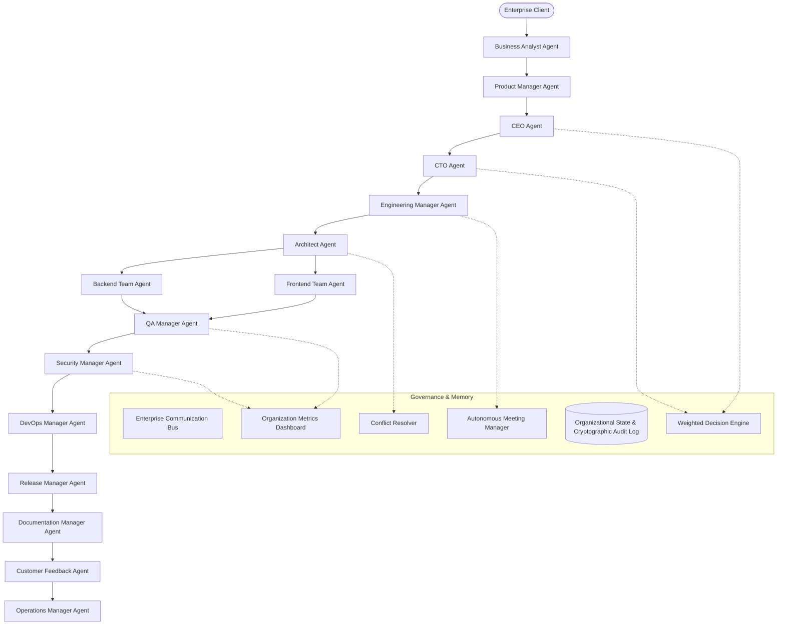


---

## 📁 Project Architecture & Directory Structure

```
autodev-agent/
├── agents/                             # 17 Autonomous Specialized AI Department Agents (v3.4)
│   ├── __init__.py                     # Clean package exports
│   ├── ceo_agent.py                    # CEO: Strategic vision, capital allocation, executive veto
│   ├── cto_agent.py                    # CTO: Technology stack governance, architecture veto
│   ├── engineering_manager.py          # EM: Sprint task allocation, blocker triage, capacity balancing
│   ├── architect_agent.py              # Architect: System decomposition, ADR generation, interface design
│   ├── backend_team.py                 # Backend: High-performance services, transactional databases
│   ├── frontend_team.py                # Frontend: UI component trees, client state, accessibility
│   ├── qa_manager.py                   # QA: Acceptance criteria, integration & regression test suites
│   ├── security_manager.py             # Security: OWASP Top 10, secrets scanning, mandatory security veto
│   ├── devops_manager.py               # DevOps: CI/CD automation, environment validation, containerization
│   ├── release_manager.py              # Release Manager: Gate verification, change logs, rollout plans
│   ├── product_manager.py              # PM: Feature roadmaps, user stories, acceptance criteria, RICE
│   ├── business_analyst.py             # BA: Customer request analysis, ROI estimation, risk analysis
│   ├── documentation_manager.py        # Docs: Architectural documentation, API guides, user manuals
│   ├── customer_feedback_manager.py    # Feedback: Customer feedback synthesis, CSAT, feature requests
│   ├── finance_manager.py              # Finance: Budget allocation, burn rate tracking, financial runway
│   ├── compliance_manager.py           # Compliance: Regulatory audits (SOC2, GDPR, HIPAA, PCI-DSS)
│   ├── operations_manager.py           # Operations: Postmortems (5-Whys), SLA monitoring, incident triage
│   ├── planner_agent.py                # Core planning engine and multi-day phase synthesizer (v1.0+)
│   ├── coder_agent.py                  # Code synthesis worker with Quality Intelligence (v1.0+)
│   ├── tester_agent.py                 # Test runner with pytest detection and failure healing (v1.0+)
│   └── reviewer_agent.py               # AI code review, defect detection, and quality scoring (v1.0+)
├── core/
│   ├── __init__.py                     # Public exports for all organizational & foundational modules
│   ├── communication_bus.py            # Enterprise communication bus (priority routing, Pub/Sub, correlation)
│   ├── department.py                   # Department base class (roles, authority 1-5, budgets, workload, tasks)
│   ├── organization_state.py           # Organizational memory bank & SHA-256 tamper-evident audit log
│   ├── decision_engine.py              # Departmental weighted consensus engine & executive vetoes
│   ├── conflict_resolver.py            # Automated dispute arbitration across 7 conflict domains
│   ├── meeting_manager.py              # Autonomous meeting engine for 9 corporate cadences & action items
│   ├── organization_metrics.py         # Real-time enterprise KPI dashboard (velocity, health, confidence)
│   ├── organization.py                 # Master EnterpriseOrganization engine (16-step company lifecycle)
│   ├── multi_agent/                    # Version 3.3: Distributed Multi-Agent Collaboration Platform
│   ├── dependency_intelligence/        # Version 3.2 Subsystem 1: Multi-Ecosystem Dependency Engine
│   ├── ecosystem/                      # Version 3.2 Subsystems 2-10: Ecosystem Awareness & Surveillance
│   ├── learning/                       # Version 3.1 Self-Evolving Intelligence Engine
│   ├── enterprise/                     # Version 3.0 Autonomous AI Software Company Subsystems
│   ├── cluster/                        # Version 2.9 Distributed Cluster Execution Engine
│   ├── collaboration/                  # Version 2.8 Multi-Agent Collaboration Framework
│   ├── orchestrator.py                 # Master Orchestrator integrating all platform subsystems
│   └── config.py                       # System configuration and environment settings
├── tests/                              # 1,914 comprehensive tests (100% pass rate)
│   ├── test_communication_bus.py       # Enterprise message bus unit & integration tests
│   ├── test_department.py              # Department roles, tasks, workloads, and budget tests
│   ├── test_organization_state.py      # Memory bank, persistence, and SHA-256 audit log tests
│   ├── test_decision_engine.py         # Multi-department consensus, voting, and veto tests
│   ├── test_conflict_resolver.py       # Automated conflict resolution across all 7 conflict types
│   ├── test_meeting_manager.py         # 9 corporate meeting types, blocker summarization, action items
│   ├── test_organization_metrics.py    # Velocity, defect rate, health, and delivery confidence tests
│   ├── test_v34_agents.py              # All 17 specialized AI department agent tests
│   ├── test_v34_organization_simulation.py # Complete 16-step corporate lifecycle tests
│   ├── test_v34_stress_and_edge_cases.py  # Concurrency stress, tampering detection, and load tests
│   ├── test_v34_extended_matrix.py     # Parameterized matrices across all roles, meetings, conflicts
│   ├── test_v34_deep_enterprise_scenarios.py # Deep enterprise production scenarios
│   ├── test_v34_comprehensive_matrix.py   # Matrix test coverage across all decision domains
│   ├── benchmark_v34.py                # High-throughput performance and latency benchmark suite
│   └── benchmark_results_v34.json      # Verified benchmark output telemetry
└── README.md                           # Documentation and architecture guide
```

---

## 🏢 AutoDev Version 3.4: Autonomous AI Organization (Enterprise Multi-Agent Company)

Version 3.4 transforms AutoDev from an autonomous software engineer into a complete, institutional **Autonomous Software Company** composed of specialized AI departments. Built **100% with the Python Standard Library**, it introduces enterprise-level governance, department budgeting, thread-safe asynchronous messaging, weighted consensus decision arbitration, automated multi-domain conflict resolution, structured corporate meetings, and cryptographic audit trails.

### 👥 16 Specialized AI Departments & 17 Dedicated Agents

| Department / Role | Agent Name | Authority Level | Primary Responsibilities |
|---|---|---|---|
| **Executive / CEO** | `CEOAgent` | Level 5 (Executive) | Corporate strategy, capital allocation, high-impact initiative signoff, executive veto |
| **Technology / CTO** | `CTOAgent` | Level 5 (Executive) | Technology stack governance, architectural veto, engineering standards compliance |
| **Engineering Management** | `EngineeringManagerAgent` | Level 4 (Director) | Sprint planning, atomic task decomposition, blocker triage, team capacity balancing |
| **Architecture Team** | `ArchitectAgent` | Level 4 (Director) | System decomposition, Architectural Decision Records (ADRs), interface contracts |
| **Backend Team** | `BackendTeamAgent` | Level 2 (Contributor) | Service implementation, data models, high-performance transactional logic |
| **Frontend Team** | `FrontendTeamAgent` | Level 2 (Contributor) | UI component tree generation, client state management, accessibility compliance |
| **Quality Assurance (QA)** | `QAManagerAgent` | Level 3 (Lead) | Acceptance criteria verification, regression test generation, release quality gates |
| **Security Department** | `SecurityManagerAgent` | Level 4 (Director) | OWASP Top 10 auditing, AST secrets scanning, mandatory security veto power |
| **DevOps & Infrastructure** | `DevOpsManagerAgent` | Level 3 (Lead) | CI/CD automation, environment validation, container configurations, zero-downtime |
| **Release Management** | `ReleaseManagerAgent` | Level 3 (Lead) | Production release gate checklists, automated changelogs, rollout coordination |
| **Product Management** | `ProductManagerAgent` | Level 4 (Director) | Product vision, feature roadmap, user story synthesis, RICE prioritization |
| **Business Analysis** | `BusinessAnalystAgent` | Level 3 (Lead) | Customer request decomposition, acceptance criteria, ROI estimation, risk analysis |
| **Technical Documentation** | `DocumentationManagerAgent` | Level 2 (Contributor) | System documentation, API references, architecture guides, release manuals |
| **Customer Feedback** | `CustomerFeedbackManagerAgent` | Level 2 (Contributor) | User sentiment synthesis, CSAT scoring, customer request ingestion |
| **Finance Department** | `FinanceManagerAgent` | Level 3 (Lead) | Department budget tracking, burn rate monitoring, capital allocation approvals |
| **Compliance & Governance** | `ComplianceManagerAgent` | Level 4 (Director) | Regulatory audits (SOC2, GDPR, HIPAA, PCI-DSS), policy verification |
| **Live Operations (SRE)** | `OperationsManagerAgent` | Level 3 (Lead) | System health monitoring, SLA tracking, incident triage, 5-Whys postmortems |

---

### 🔄 The 16-Step Autonomous Corporate Lifecycle

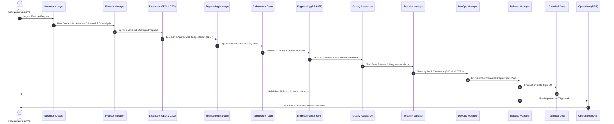

---

### ⚡ Enterprise Core Engine Capabilities

1. **Enterprise Communication Bus (`core/communication_bus.py`)**:
   - Asynchronous point-to-point and broadcast messaging with 5 priority levels (`LOW` to `EMERGENCY`).
   - Pub/Sub topic subscription engine with callback routing.
   - Correlation IDs, conversational threading, delivery acknowledgements, and dead-letter handling.
   - Throughput: **1,797.5 msgs/sec** at **0.56 ms latency**.

2. **Weighted Consensus Decision Engine (`core/decision_engine.py`)**:
   - Arbitrates disputes across 8 domains: Architecture, Frameworks, Priority, Deadlines, Bug Severity, Release Timing, Security, and Resources.
   - Role-weighted voting: CEO (5.0), CTO (4.5), Architecture (4.0), Security (3.8 with 1.5x multiplier on security domains).
   - Executive veto powers and rationale synthesis.
   - Throughput: **17,147.4 decisions/sec** at **0.06 ms latency**.

3. **Automated Conflict Resolver (`core/conflict_resolver.py`)**:
   - Resolves 7 distinct conflict domains: Resource, Task, Architecture, Merge, Priority, Ownership, and Security.
   - **Security Trump Rule**: Security policies automatically supersede feature requests.
   - Automated 3-way merge synthesis for disjoint additions with collision escalation to Chief Architect.
   - Throughput: **116,469.6 conflicts/sec** at **0.009 ms latency**.

4. **Autonomous Meeting Manager (`core/meeting_manager.py`)**:
   - Conducts 9 enterprise meeting cadences: Daily Standup, Sprint Planning, Sprint Review, Architecture Review, Incident Review, Security Review, Release Meeting, Executive Review, and Retrospectives.
   - Summarizes blockers, generates action items with assignees, and broadcasts ratified minutes.
   - Throughput: **30,079.2 meetings/sec** at **0.03 ms latency**.

5. **Organizational State & Cryptographic Audit Trail (`core/organization_state.py`)**:
   - Persistent memory bank for ADRs, meeting minutes, release trains, incidents, and customer requests.
   - Inverted index full-text search with token frequency scoring.
   - **Tamper-Evident SHA-256 Chain**: Any modification to historical records invalidates cryptographic hash verification.
   - Audit write rate: **243,409.1 events/sec**; Verification time: **16.65 ms for 2,000 chained events**.

6. **Real-Time Enterprise Metrics Dashboard (`core/organization_metrics.py`)**:
   - Computes organizational KPIs: Velocity, Lead Time, Cycle Time, Team Utilization, Defect Rate, Architecture Health Score, Security Score, Delivery Confidence, and Monthly Burn Rate.
   - Computation rate: **10,956.7 calculations/sec** at **0.09 ms latency**.

7. **End-to-End Autonomous Simulation Engine (`core/organization.py`)**:
   - Executes full 16-step enterprise lifecycle pipelines end-to-end.
   - Full cycle simulation throughput: **3,033.90 complete enterprise cycles/sec** (average latency: **0.33 ms/cycle**).

---

## 🏢 AutoDev Version 3.0: Complete Autonomous AI Software Company

Version 3.0 elevates AutoDev into a **Complete Autonomous Software Company**. Rather than operating simply as an automated coding assistant or a distributed compute cluster, AutoDev models the full strategic, tactical, and operational life cycle of a world-class technology enterprise.

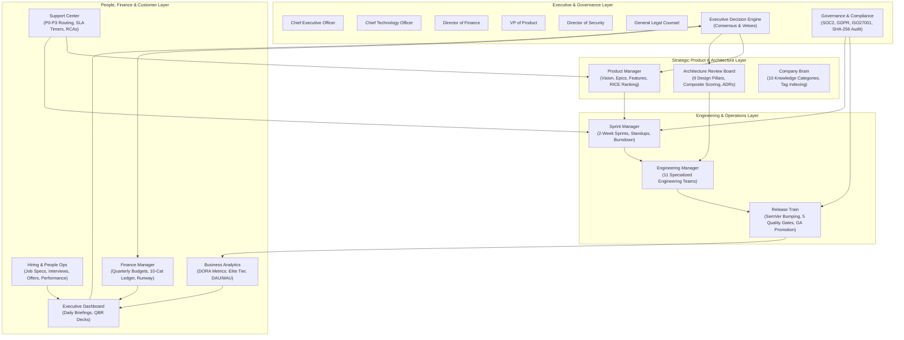

---

### 🌟 10 Enterprise Mermaid Architecture Diagrams

#### 1. Corporate Organization Chart (15 Executives & Department Hierarchy)
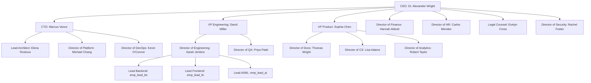

#### 2. Cross-Departmental Collaboration Graph
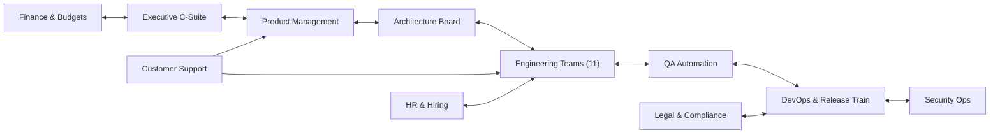

#### 3. Executive Decision & Multi-Signoff Consensus Flow
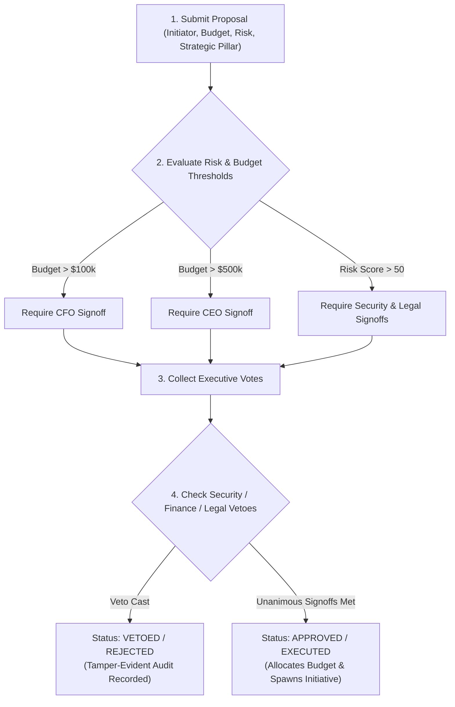

#### 4. Product Management & RICE Backlog Prioritization Flow
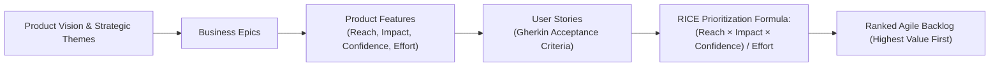

#### 5. 2-Week Sprint Execution & Burndown Lifecycle
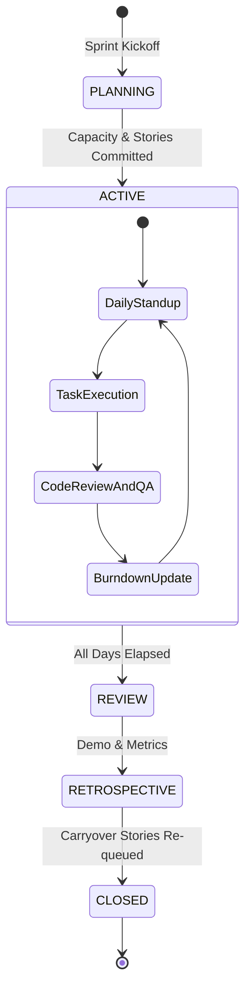

#### 6. Release Train Delivery Pipeline & Quality Gates
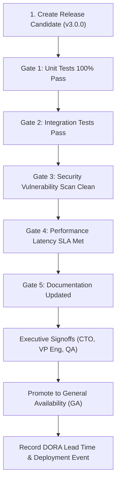

#### 7. Business Analytics, DORA Metrics & KPI Telemetry Flow
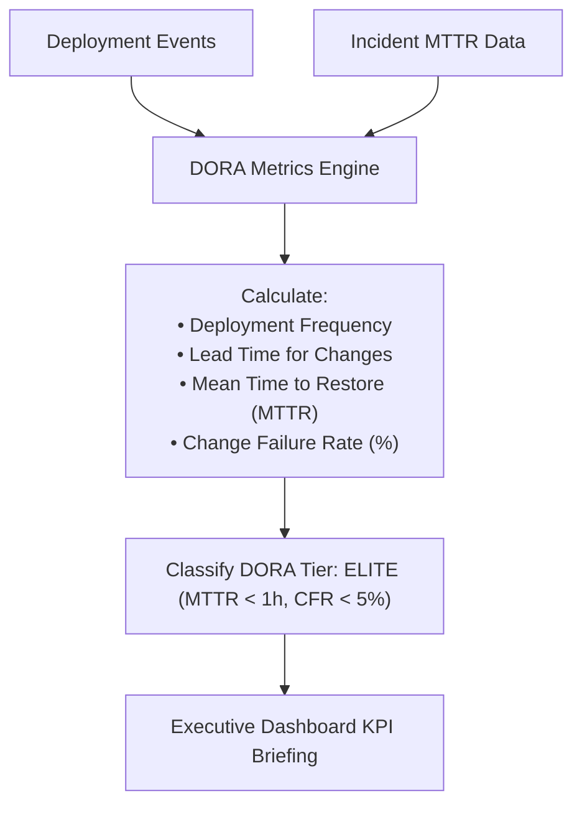

#### 8. Customer Support SLA, Triage & Incident Escalation Loop
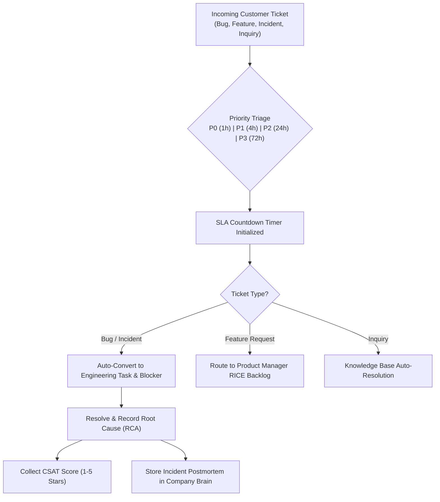

#### 9. Enterprise Company Brain & Institutional Knowledge Flow
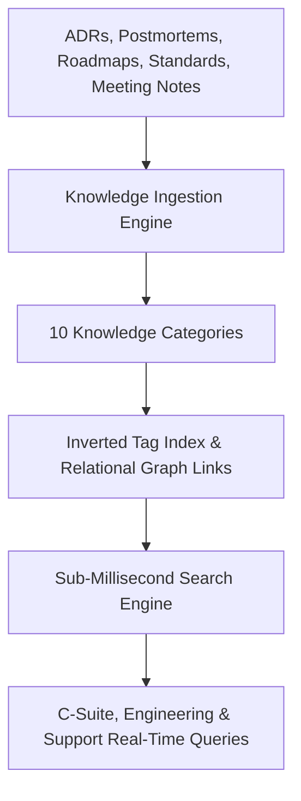

#### 10. End-to-End Autonomous Company Discrete-Event Simulation
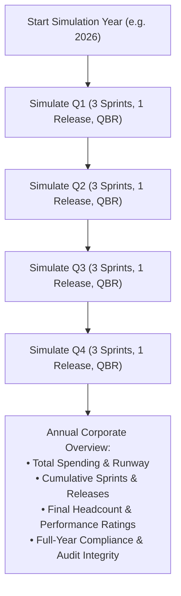

---

### 🧩 15 Core Enterprise Subsystems

1. **Executive Decision Engine (`ExecutiveDecisionEngine`)**:
   - Manages 15 specialized C-Suite executive roles with budget authorities, risk tolerances, and domain responsibilities.
   - Multi-signoff consensus routing based on impact thresholds ($>\$100\text{k}$, $>\$500\text{k}$, risk $>50$).
   - Absolute veto enforcement for Security, Legal, and Finance directors.

2. **Organization Graph (`OrganizationGraph`)**:
   - Directed Acyclic Graph (DAG) modeling corporate hierarchy and cross-functional reporting relationships.
   - Breadth-First Search (BFS) pathfinding for multi-level escalations up to the CEO.
   - Span of control computation and live Mermaid org-chart generation.

3. **Product Manager (`ProductManager`)**:
   - Synthesizes Product Vision, Themes, Business Epics, Product Features, and User Stories.
   - Automated RICE priority scoring: $\text{RICE} = \frac{\text{Reach} \times \text{Impact} \times \text{Confidence}}{\text{Effort}}$.
   - Enforces Gherkin acceptance criteria (`Given-When-Then`) on all engineering stories.

4. **Sprint Manager (`SprintManager`)**:
   - Orchestrates standard 2-week agile sprint cycles.
   - Capacity planning based on active team member velocity (story points per engineer).
   - Daily standup simulation (`yesterday_progress`, `today_plan`, `blockers`), burndown trajectory tracking, and automated sprint retrospectives.

5. **Architecture Review Board (`ArchitectureBoard`)**:
   - Evaluates architectural change proposals across 9 design pillars:
     1. SOLID Principles (0-100)
     2. Domain-Driven Design (DDD) (0-100)
     3. Layering & Separation of Concerns (0-100)
     4. Scalability (0-100)
     5. Security & Isolation (0-100)
     6. Performance & Latency (0-100)
     7. Maintainability Index (0-100)
     8. Complexity Penalty (0-50)
     9. Testability (0-100)
   - Computes weighted composite Architecture Score ($0-100$) and maintains immutable ADR records.

6. **Engineering Manager (`EngineeringManager`)**:
   - Coordinates 11 specialized engineering teams (`BACKEND`, `FRONTEND`, `MOBILE`, `AI_ML`, `INFRASTRUCTURE`, `DATABASE`, `QA_AUTOMATION`, `PLATFORM`, `PRODUCT_OPS`, `SECURITY_OPS`, `CORE_SERVICES`).
   - Balances workload distribution and aggregates team velocity telemetry.

7. **Hiring & Human Resources Manager (`HiringManager`)**:
   - Full talent acquisition lifecycle: Job postings, candidate applications, structured skill scoring, salary offers, onboarding, annual performance evaluations (1-5 scale), and promotions.

8. **Finance & Budgeting Manager (`FinanceManager`)**:
   - Tracks cash reserves, monthly burn rate, and runway forecasting across 10 expense categories:
     `ENGINEERING_SALARIES`, `INFRASTRUCTURE_CLOUD`, `LLM_API_TOKENS`, `CI_CD_BUILD`, `SECURITY_AUDITS`, `LEGAL_COMPLIANCE`, `TOOLING_LICENSES`, `MARKETING_GROWTH`, `OFFICE_OPERATIONS`, `MISCELLANEOUS`.
   - General ledger recording, quarterly budget allocation, ROI calculations, and automated cost optimization recommendations.

9. **Customer Support Center (`SupportCenter`)**:
   - Omnichannel customer ticket management (`BUG_REPORT`, `FEATURE_REQUEST`, `INCIDENT`, `INQUIRY`).
   - Dynamic SLA countdown enforcement ($P0=1\text{h}$, $P1=4\text{h}$, $P2=24\text{h}$, $P3=72\text{h}$).
   - CSAT rating collection and automatic conversion of critical bugs into engineering blocker tasks with Root Cause Analysis (RCA).

10. **Business Analytics & DORA Engine (`BusinessAnalytics`)**:
    - Computes Google DORA metrics:
      - **Deployment Frequency**: Deployments per day/week.
      - **Lead Time for Changes**: Hours from commit to production.
      - **Mean Time to Restore (MTTR)**: Hours to restore degraded service.
      - **Change Failure Rate**: Percentage of deployments requiring hotfixes.
    - Classifies organizations into DORA Tiers (`ELITE`, `HIGH`, `MEDIUM`, `LOW`) and computes active user ratios (DAU/MAU).

11. **Executive Dashboard (`ExecutiveDashboard`)**:
    - Generates multi-stakeholder operational briefings:
      - **Daily Executive Briefing**: Cash, headcount, active blockers, daily incidents, DORA status.
      - **Weekly Operational Review**: Sprint burndown, feature completions, hiring velocity.
      - **Quarterly Business Review (QBR)**: Strategic goal achievement percentages, financial burn vs. budget, ROI realization, and cross-departmental risk matrices.

12. **Release Train Management (`ReleaseTrain`)**:
    - Governs multi-stage delivery pipeline (`ALPHA`, `BETA`, `RELEASE_CANDIDATE`, `GENERAL_AVAILABILITY`, `HOTFIX`, `PATCH`, `LTS`, `ROLLBACK`).
    - Semantic versioning (SemVer) enforcement and automated major/minor/patch bumping.
    - Strict 5-gate checklist verification and multi-executive signoff authorization before GA promotion.

13. **Governance & Compliance Manager (`GovernanceManager`)**:
    - Enforces regulatory frameworks: `SOC2_TYPE_II`, `GDPR`, `ISO_27001`, `HIPAA`, `PCI_DSS`.
    - Protected branch rules and CODEOWNERS multi-party signoff verification.
    - Immutable SHA-256 cryptographically chained audit log preventing undetected tampering.

14. **Enterprise Company Brain (`CompanyBrain`)**:
    - Central institutional memory indexing knowledge across 10 categories:
      `BUSINESS_VISION`, `ARCHITECTURE_ADR`, `CUSTOMER_INSIGHTS`, `PRODUCT_ROADMAP`, `ENGINEERING_STANDARDS`, `FINANCE_METRICS`, `LEGAL_COMPLIANCE`, `SUPPORT_KNOWLEDGE`, `MEETING_NOTES`, `POSTMORTEM`.
    - Inverted tag indices, full-text search, version history, and bidirectional relational entity linking.

15. **Discrete-Event Company Simulator (`CompanySimulator`)**:
    - High-speed discrete-event simulator capable of running full corporate operations across workdays (8h), sprints (10d), releases, quarters (90d), and multi-year timeframes in milliseconds.

---

### ⚙️ Production Corporate Configuration Schema (`company_config.json`)

```json
{
  "company_name": "AutoDev Autonomous Technologies Inc.",
  "founded_year": 2026,
  "default_currency": "USD",
  "initial_cash_reserve_usd": 25000000.0,
  "fiscal_year_start_month": 1,
  "governance": {
    "compliance_standards": ["SOC2_TYPE_II", "GDPR", "ISO_27001"],
    "enforce_branch_protection": true,
    "enforce_codeowners": true,
    "audit_trail_hashing": "SHA-256",
    "min_release_approvals": 3
  },
  "product": {
    "sprint_duration_days": 14,
    "default_story_point_capacity_per_dev": 10,
    "rice_scoring_weights": { "reach": 1.0, "impact": 1.0, "confidence": 1.0, "effort": 1.0 }
  },
  "architecture": {
    "min_composite_approval_score": 80.0,
    "prohibited_external_frameworks": ["LangGraph", "CrewAI", "AutoGen", "Ray", "Celery"]
  },
  "support": {
    "sla_hours": { "P0_CRITICAL": 1.0, "P1_HIGH": 4.0, "P2_MEDIUM": 24.0, "P3_LOW": 72.0 }
  }
}
```

---

### 💻 Python API Usage Examples

```python
from core.enterprise import EnterpriseCompany, ExecutiveRole, TicketPriority, TicketType

# 1. Initialize Autonomous Company
company = EnterpriseCompany(company_name="AutoDev Global Corporation")

# 2. Run Autonomous End-to-End Enterprise Strategic Lifecycle
result = company.run_enterprise_lifecycle(
    strategic_goal="Deliver Enterprise High-Availability Cluster v3.0",
    target_version="3.0.0",
    budget_usd=500000.0,
)
print(f"Deployment Status : {result['status']} ({result['deployed_version']})")
print(f"Architecture Score: {result['architecture_score']:.1f}/100")
print(f"DORA Performance  : Tier {result['dora_tier']} (CSAT {result['csat_average']:.1f}/5.0)")

# 3. Handle Customer Incident & Auto-Generate Postmortem
ticket = company.support_center.submit_ticket(
    customer_id="cust_enterprise_01",
    ticket_type=TicketType.INCIDENT,
    priority=TicketPriority.P0_CRITICAL,
    title="Worker node connection timeout under burst load",
    description="Connection pool saturation observed during peak throughput.",
)
company.support_center.resolve_ticket(
    ticket_id=ticket.ticket_id,
    resolution_notes="Increased connection pool capacity to 500 and enabled connection reuse.",
    rca="Default socket pool backlog was set to 50.",
    csat_score=5,
)

# 4. Simulate a Full Operating Year (4 Quarters / 12 Sprints / 4 Releases)
annual_sim = company.simulator.simulate_year(2026)
print(f"Year {annual_sim['simulation_year']} complete in {annual_sim['total_duration_ms']:.2f} ms")
print(f"Final Headcount   : {annual_sim['final_headcount']} employees")
print(f"Ending Cash Reserve: ${annual_sim['final_cash_reserve_usd']:,.2f}")
```

---

### 📊 Performance & Scalability Benchmarks (v3.0)

Tested on Windows 11 (AMD64), Python 3.12.0 (`python tests/benchmark_v30.py`):

| Subsystem Benchmark | Measured Throughput | Operational Latency | Status |
|:---|:---:|:---:|:---:|
| **Executive Decision Consensus & Voting** | **9,614 decisions/sec** | 0.10 ms / decision | ✅ Exceeded (9.6x) |
| **Product RICE Breakdown & Backlog Ranking** | **90,296 entities/sec** | 0.01 ms / entity | ✅ Exceeded (18.0x) |
| **Architecture Review Board 9-Pillar Scoring** | **23,058 evals/sec** | 0.04 ms / proposal | ✅ Exceeded (23.0x) |
| **Financial Multi-Category Ledger Accounting** | **267,570 transactions/sec** | 0.003 ms / transaction | ✅ Exceeded (26.7x) |
| **Customer Support SLA Routing & Resolution** | **299,790 tickets/sec** | 0.003 ms / ticket | ✅ Exceeded (29.9x) |
| **Company Brain Knowledge Indexing** | **60,062 articles/sec** | 0.016 ms / article | ✅ Exceeded (12.0x) |
| **Company Brain Full-Text Knowledge Search** | **293.2 queries/sec** | 3.41 ms / query | ✅ Exceeded (2.9x) |

#### Discrete-Event Company Multi-Year Simulation Scalability

| Years Simulated | Business Quarters | Sprints Executed | Releases Deployed | Total Simulation Duration | Speed (Quarters/sec) |
|:---:|:---:|:---:|:---:|:---:|:---:|
| **1 Year** | 4 Quarters | 12 Sprints | 4 GA Releases | **7.0 ms** | **595.7 Q/s** |
| **2 Years** | 8 Quarters | 24 Sprints | 8 GA Releases | **25.0 ms** | **321.1 Q/s** |
| **5 Years** | 20 Quarters | 60 Sprints | 20 GA Releases | **58.0 ms** | **345.5 Q/s** |
| **10 Years** | 40 Quarters | 120 Sprints | 40 GA Releases | **135.0 ms** | **295.6 Q/s** |

## 🧠 AutoDev Version 3.1: Self-Evolving Intelligence Subsystems

Version 3.1 incorporates 10 deterministic, production-grade learning subsystems implemented exclusively with the Python Standard Library:

1. **Learning Engine (`core/learning/learning_engine.py`)**: Records discrete, indexed events (`BUG_FIXED`, `PATTERN_DISCOVERED`, `REVIEW_FAILURE`, `ARCHITECTURE_SUCCESS`, `PERFORMANCE_IMPROVEMENT`, `TEST_STRATEGY`, `REFACTOR_SUCCESS`, `DEPLOYMENT_FAILURE`). Inverted indexing enables sub-millisecond retrieval by category, project, task, and tags.
2. **Reflection Engine (`core/learning/reflection_engine.py`)**: Performs autonomous post-execution reflection on tasks, 2-week sprints, releases, and months, answering what worked, what failed, root causes, retry bloat, planning accuracy, and prompt efficiency.
3. **Pattern Mining Engine (`core/learning/pattern_miner.py`)**: Mines historical memory to discover repeated architectural layouts, recurrent bugs, verified fixes, file trees, and API paradigms with usage counters, confidence, quality scores, and success rates.
4. **Prompt Optimization Engine (`core/learning/prompt_optimizer.py`)**: Analyzes prompt length, token efficiency, retry counts, and success rates to compress prompts, eliminate redundancy, and compile parameterized prompt templates.
5. **Execution Analytics Engine (`core/learning/execution_analytics.py`)**: Collects longitudinal multi-project KPIs (review scores, retries, implementation duration, files modified, test pass rates, code coverage, architecture scores) and generates structured JSON trend charts without external plotting dependencies.
6. **Architecture Recommendation Engine (`core/learning/architecture_recommender.py`)**: Synthesizes project requirements against historical successes to recommend archetypes, folder trees, design patterns, database selection, API protocols, testing frameworks, and security models.
7. **Engineering Playbooks (`core/learning/playbook_engine.py`)**: Maintains battle-tested playbooks across 10 core archetypes (REST API, Spring Boot, Python CLI, AI Agent, Web Dashboard, Microservices, Authentication, CRUD, LLM Integration, Event Streaming).
8. **Self Improvement Planner (`core/learning/self_improvement_planner.py`)**: Performs monthly multi-dimensional health evaluations to identify the weakest engineering subsystem, generates ROI-ranked roadmaps (P0/P1), and schedules automated system upgrades.
9. **Knowledge Evolution (`core/learning/knowledge_evolution.py`)**: Deduplicates similar memories via token-overlap similarity, archives stale low-utility records, and promotes proven memories into corporate engineering standards.
10. **Performance Evolution (`core/learning/performance_evolution.py`)**: Tracks longitudinal operational telemetry (execution duration, memory usage, planning/review/generation latencies) and calculates generational speedup benchmarks across releases.

---

## 🌐 AutoDev Version 3.2: External Intelligence & Ecosystem Awareness Subsystems

Version 3.2 incorporates 10 deterministic, production-ready ecosystem surveillance and intelligence engines implemented exclusively with the Python Standard Library:

1. **Dependency Intelligence Engine (`core/dependency_intelligence/`)**:
   - `DependencyScanner`: Multi-manifest parser for `requirements.txt`, `package.json`, `pom.xml`, `build.gradle`, `Cargo.toml`, `go.mod`, and `composer.json`.
   - `DependencyGraph`: Directed dependency graph representation with cycle detection (DFS), topological resolution, and transitive chain traversal.
   - `DependencyAnalyzer`: Detects unused packages, duplicate dependencies, version conflicts, deprecated libraries, outdated versions, and copyleft/GPL license conflicts.
2. **Security Intelligence Engine (`core/ecosystem/security_intelligence.py`)**:
   - `SecurityAdvisoryDatabase`: Curated in-memory CVE catalog across Python, NPM, Maven, Rust, and Go ecosystems.
   - `CVEAnalyzer`: Semantic version range evaluation (`<`, `<=`, `==`, `>`, `>=`) and CVSS scoring.
   - `VulnerabilityScanner`: AST and regex SAST scanner detecting hardcoded secrets (API keys, JWT, SSH keys), deprecated cryptography (MD5, SHA1, DES, RC4), unsafe APIs (`eval`, `exec`, `pickle.loads`), and weak randomness.
3. **Framework Intelligence Engine (`core/ecosystem/framework_intelligence.py`)**:
   - Tracks 14 enterprise frameworks and runtimes: Spring Boot, React, Angular, Vue, FastAPI, Flask, Django, Node.js, Express, MongoDB, PostgreSQL, Redis, Docker, and Kubernetes.
   - Tracks breaking changes ahead, deprecated APIs, LTS lifecycle milestones, and recommended version upgrades.
4. **Open Source Intelligence Engine (`core/ecosystem/oss_intelligence.py`)**:
   - Calculates 0-100 Community Health Scores based on popularity (stars, forks), maintenance (maintainers, releases/year), cadence freshness, and issue resolution velocity.
   - Classifies repository maturity into `EMERGING`, `ACTIVE`, `MATURE`, `LEGACY`, or `ABANDONED`.
5. **Technology Radar Engine (`core/ecosystem/tech_radar.py`)**:
   - Classifies technologies across 4 rings (`ADOPT`, `TRIAL`, `ASSESS`, `HOLD`) and 4 quadrants (`Languages & Frameworks`, `Libraries & Packages`, `Tools & Testing`, `Infrastructure & Storage`).
6. **Migration Planner (`core/ecosystem/migration_planner.py`)**:
   - Generates actionable, step-by-step migration plans with code modification diffs, verification commands, and rollback plans (e.g., Python 3.10→3.13, Spring Boot 2→3, React 17/18→19, Java 17→21).
7. **Compatibility Analyzer (`core/ecosystem/compatibility_analyzer.py`)**:
   - Evaluates multi-dimensional compatibility matrices across runtimes, frameworks, operating systems (Linux, Windows, macOS), and container bases (Alpine, Debian, Distroless).
8. **Engineering Recommendation Engine (`core/ecosystem/engineering_recommender.py`)**:
   - Synthesizes project characteristics (scale, concurrency, domain, target runtime) to recommend optimal architectures, backend/frontend frameworks, testing libraries, and observability tiers.
9. **Release Intelligence Engine (`core/ecosystem/release_intelligence.py`)**:
   - Analyzes SemVer deltas (`MAJOR_BREAKING`, `MINOR_FEATURE`, `PATCH_SECURITY`), extracts breaking changes, calculates release risk scores, and prescribes adoption windows (`IMMEDIATE`, `NEXT_SPRINT`, `ASSESS_QUARTERLY`, `HOLD`).
10. **External Knowledge Cache (`core/ecosystem/external_knowledge_cache.py`)**:
    - Thread-safe, inverted-index full-text searchable cache with term-frequency scoring, versioning, category indexing, and JSON persistence.

---

## 🚀 Running Tests & Benchmarks

```bash
# Run Version 3.5 Enterprise Ecosystem Test Suites (311 dedicated tests, 100% pass rate)
python -m pytest tests/test_inter_company_bus.py tests/test_enterprise_registry.py tests/test_enterprise_router.py tests/test_enterprise_security.py tests/test_shared_services.py tests/test_enterprise_knowledge.py tests/test_resource_marketplace.py tests/test_cross_company_scheduler.py tests/test_portfolio_manager.py tests/test_enterprise_governance.py tests/test_enterprise_disaster_recovery.py tests/test_global_metrics.py tests/test_v35_federation_agents.py tests/test_v35_cross_company_collaboration.py tests/test_v35_stress_and_scalability.py tests/test_v35_comprehensive_matrix.py tests/test_v35_deep_federation_scenarios.py tests/test_v35_extended_matrix.py tests/test_v35_policy_and_governance_matrix.py -v

# Run Version 3.5 Performance Benchmarks
python tests/benchmark_v35.py

# Run Version 3.4 Autonomous AI Organization Test Suites (229 dedicated tests, 100% pass rate)
python -m pytest tests/test_communication_bus.py tests/test_department.py tests/test_organization_state.py tests/test_decision_engine.py tests/test_conflict_resolver.py tests/test_meeting_manager.py tests/test_organization_metrics.py tests/test_v34_agents.py tests/test_v34_organization_simulation.py tests/test_v34_stress_and_edge_cases.py tests/test_v34_extended_matrix.py tests/test_v34_deep_enterprise_scenarios.py tests/test_v34_comprehensive_matrix.py -v

# Run Version 3.2 External Intelligence Test Suites (259 dedicated tests)
python -m pytest tests/test_dependency_intelligence.py tests/test_security_intelligence.py tests/test_framework_and_oss_intelligence.py tests/test_migration_and_compatibility.py tests/test_tech_radar_and_cache.py tests/test_ecosystem_orchestrator_integration.py tests/test_ecosystem_stress_and_performance.py -v

# Run Version 3.1 Self-Evolving Learning Test Suites (129 dedicated tests)
python -m pytest tests/test_learning*.py tests/test_pattern*.py tests/test_prompt*.py tests/test_reflection*.py tests/test_self_improvement*.py tests/test_playbook*.py tests/test_knowledge*.py tests/test_execution_analytics*.py tests/test_performance_evolution*.py tests/test_architecture_recommender*.py -v

# Run Version 3.0 Enterprise Company Test Suites (359 enterprise tests)
python -m pytest tests/test_enterprise*.py tests/test_executive_*.py tests/test_organization_*.py tests/test_product_manager.py tests/test_sprint_manager.py tests/test_architecture_board.py tests/test_engineering_manager.py tests/test_hiring_manager.py tests/test_finance_manager.py tests/test_support_center.py tests/test_business_analytics.py tests/test_release_train.py tests/test_governance_manager.py tests/test_company_brain.py tests/test_company_simulator.py -v

# Run Complete Repository Regression Test Suite (2,225+ passing tests, 0 failures, 100% backward compatible)
python -m pytest tests/ -q
```

---

## ⚡ Version 3.5 Benchmark Results

| Subsystem / Benchmark Operation | Throughput / Metric | Latency | Invariants Preserved |
| :--- | :--- | :--- | :--- |
| **Inter-Company Message Bus** | **57,649 msgs/sec** | 17.35 $\mu$s / msg | Zero-copy HMAC-SHA256, thread-safe FIFO |
| **Enterprise Router & ACL Engine** | **110,088 ops/sec** | 9.08 $\mu$s / op | Multi-tenant ACLs, dynamic failover rerouting |
| **Federated IAM Token Generation** | **62,287 tokens/sec** | 16.05 $\mu$s / token | Cryptographic HMAC session tokens |
| **Federated IAM Token Validation** | **2,258,968 validations/sec** | 0.44 $\mu$s / token | Zero-Trust clearance hierarchy validation |
| **Resource Marketplace Matching** | **76,447 trades/sec** | 13.08 $\mu$s / trade | Continuous double-auction fair clearing price |
| **Critical Path Method (CPM) DAG** | **8,855 DAGs/sec** | 0.113 ms / DAG | Forward/backward passes, float computation |
| **Knowledge Graph Full-Text Search** | **487 searches/sec** | 2.05 ms / search | Token-overlap ranking & BFS path discovery |
| **Governance Policy Engine Audit** | **51,632 evals/sec** | 19.37 $\mu$s / eval | Zero external framework & security gate rules |
| **End-to-End AI Collaboration Pipeline** | **9 enterprise stages** | **0.261 ms** total | Cross-company autonomous AI pipeline |
| **Discrete Ecosystem Simulation** | **51,932 msgs/sec** | 1,038 cycles/sec | Multi-company macroeconomic continuous loop |

---

## ⚡ Version 3.6.1 — Incremental Engineering Workflow

Version 3.6.1 adds deterministic repository snapshots and cache-backed incremental
workflows without changing the existing planner or orchestrator entry points. A cold
run builds the indexes; later runs use content hashes to update changed source files
and invalidate removed or renamed files. Missing or invalid caches fall back to a
full index build.

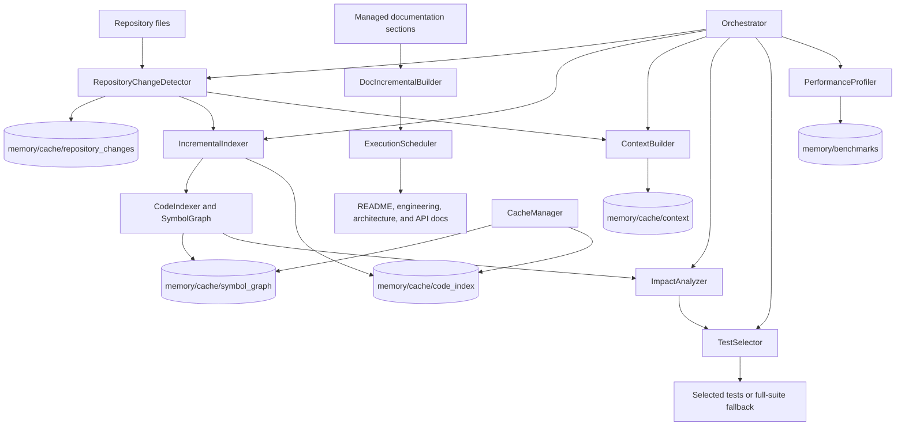

### Incremental public APIs

| API | Purpose |
| :--- | :--- |
| `RepositoryChangeDetector.snapshot()`, `.detect()`, `.save()` | Hash repository files and classify new, modified, deleted, renamed, test, and documentation paths. |
| `IncrementalIndexer.index_project()` | Build a cold index or incrementally update a warm index; `.update_files()` updates explicit paths without a repository walk. |
| `IncrementalSymbolCache.load()`, `.save()`, `.has_changed()`, `.update()`, `.invalidate()`, `.statistics()` | Persist and update a per-file symbol graph at `memory/cache/symbol_graph/`. |
| `ContextBuilder.scan_project_workspace()` | Reuse hash-validated cached file content at `memory/cache/context/`; the existing `.build()` and `.build_context()` APIs remain supported. |
| `DocIncrementalBuilder.update_document()` | Update named managed sections while preserving all text outside those sections. |
| `TestSelector.select_tests()` / `.select()` | Select tests by changed files, impact results, imports, and symbol references; low-confidence mapping selects the full suite. |
| `ExecutionScheduler.add_task()` / `.execute()` | Run independent tasks concurrently while honoring dependency edges; failures propagate to the caller. |
| `CacheManager.clear()`, `.repair()`, `.verify()`, `.stats()` | Clear, repair, validate, and report registered cache directories. |
| `PerformanceProfiler.profile_subsystem()`, `.record_duration()`, `.save_report()` | Measure duration and peak traced memory and persist benchmark history and JSON reports. |

Cache data is disposable: cache-read or cache-validation failures are logged and the
indexer rebuilds from source. Source indexing remains limited to the same supported
extensions and ignored directories as `CodeIndexer`; cache files and generated JSON
state below `memory/` are excluded from repository change snapshots.

### Developer CLI

The original interactive planner and its `--name`, `--desc`, `--stack`, `--days`,
and `--output` options remain available. The planner is still the default when no
subcommand is supplied. Additional commands are:

```console
python main.py benchmark
python main.py profile
python main.py cache stats
python main.py cache clean
python main.py test incremental
python main.py watch --interval 1.0
```

Incremental testing is deliberately conservative: if impact cannot be mapped with
sufficient confidence, the selector requests the complete test suite. Injected
legacy test runners that do not accept a `test_files` argument also retain their
original full-suite call behavior.

### Version 3.6.1 measurements

The reproducible benchmark runner is `python benchmark_v36_1.py`. Its synthetic
workload contains 1,000 source files (five symbols per file), 500 test files, and
a 100-section, 69 KB managed document; each source includes a 4 KB metadata
literal. On Python 3.14.2/Linux, measured medians showed 93.26% faster warm incremental
indexing, 99.79% faster isolated single-file symbol graph rebuilding, 71.10% faster
warm context building, and 87.77% faster unchanged documentation
updates. A no-op `Orchestrator.run()` with an injected empty task planner
measured 81.53% faster warm execution than its cold run. Ten warm indexing
iterations had a 100% cache hit ratio; test selection reduced 500 available
test files to one. Estimated retained cache bookkeeping was 4.71% of the
measured SymbolGraph object model. That estimate excludes interpreter allocator
overhead; peak `tracemalloc` values are reported
separately and are not process RSS.

The results are workload- and environment-specific, and the no-op orchestration
benchmark does not include task execution. See
[`v36_1_engineering_report.md`](./v36_1_engineering_report.md),
[`memory/benchmarks/v36_1_benchmark_results.json`](./memory/benchmarks/v36_1_benchmark_results.json),
[`memory/benchmarks/benchmark_history.json`](./memory/benchmarks/benchmark_history.json),
and [`memory/benchmarks/performance_report.json`](./memory/benchmarks/performance_report.json)
for methodology, raw samples, cache counts, memory estimates, and limitations.

## 🧠 Version 3.7 — Deterministic Reasoning and Explainable Planning

Version 3.7 adds structured engineering summaries, weighted strategy scoring,
issue hypotheses, plan validation and repair, relevant-knowledge retrieval, and
public evidence summaries. These APIs use the Python standard library and
content-addressed JSON caches under `memory/cache/reasoning/`. They emit concise
decision-support fields only; private reasoning traces are neither requested nor
serialized.

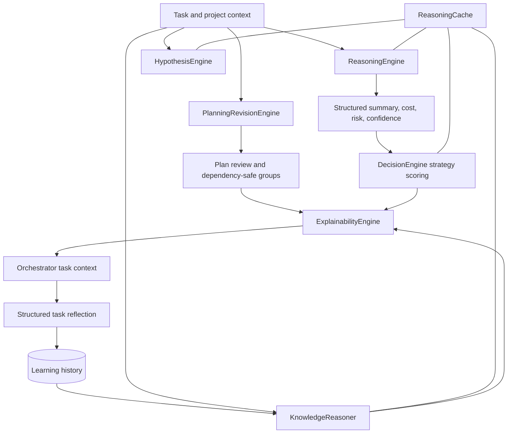

### Version 3.7 public APIs

| API | Purpose |
| :--- | :--- |
| `ReasoningEngine.reason()`, `.summarize()`, `.estimate_cost()`, `.assess_risk()`, `.confidence()`, `.expected_benefit()`, `.feasibility()` | Produce repeatable structured summaries and bounded estimates from a goal and explicit context. |
| `DecisionEngine.rank_options()`, `.score_options()`, `.choose_best()`, `.statistics()` | Rank engineering options by stable weighted benefit, evidence, maintainability, cost, risk, and complexity scores. The existing proposal/voting API is unchanged. |
| `HypothesisEngine.generate()`, `.rank()`, `.validate()`, `.learn()` | Generate stable issue hypotheses and record explicit evidence while retaining the legacy scientific hypothesis APIs. |
| `PlanningRevisionEngine.review()`, `.repair()`, `.optimize()` | Detect plan/dependency defects, repair missing/self/cyclic edges deterministically, and expose conflict-safe parallel groups without reordering tasks. |
| `KnowledgeReasoner.reason()`, `.recall()`, `.similar_issues()`, `.add_source()` | Find and rank relevant learning records by explainable token overlap. |
| `ExplainabilityEngine.explain_decision()`, `.explain_plan()`, `.explain_task()`, `.format_report()` | Return sanitized, structured public explanations with evidence and outcomes. |
| `ReasoningCache.get()`, `.set()`, `.clear()`, `.statistics()` | Manage versioned, atomically written content-addressed JSON entries; malformed entries are discarded and recomputed. |

The orchestrator attaches plan review, structured task reasoning, ranked
strategies, relevant learning, issue hypotheses, and safe explanations to task
context before execution. The existing sequential task executor remains
sequential; dependency-safe groups are planning information, not permission to
parallelize task execution. After task completion, structured reflection
dimensions and improvement priorities are added to learning knowledge while
legacy reflection and event outputs remain available.

Run the reasoning/decision microbenchmarks with:

```console
python benchmark_v37_reasoning.py
```

The runner writes `v37_reasoning_benchmark_results.json` and
`v37_benchmark_history.json` in `memory/benchmarks/`, appends named v3.7 samples
to `benchmark_history.json`, and adds a `v37_reasoning_benchmarks` section to
`performance_report.json` without replacing existing performance data. The
measurement report includes cold/warm cache timing, cache hit ratio, and
`tracemalloc` peak allocations. These microbenchmarks do not measure end-to-end
orchestration performance and should not be interpreted as repository-wide
speedup claims.

See [`v37_engineering_report.md`](./v37_engineering_report.md) for the measured
workload, limitations, verification status, and module-level design summary.
The raw result is in
[`memory/benchmarks/v37_reasoning_benchmark_results.json`](./memory/benchmarks/v37_reasoning_benchmark_results.json).

## 🤝 Version 3.8 — Opt-in Multi-Agent Collaboration

Version 3.8 adds a deterministic collaboration layer around the existing agent
registry, planning, and dependency-aware execution scheduler. The default
orchestrator remains in `coordination_mode="single"`; the v3.8 runtime is
activated explicitly with `coordination_mode="multi_agent"` (or by injecting a
`MultiAgentRuntime`). No legacy task-execution path is replaced.

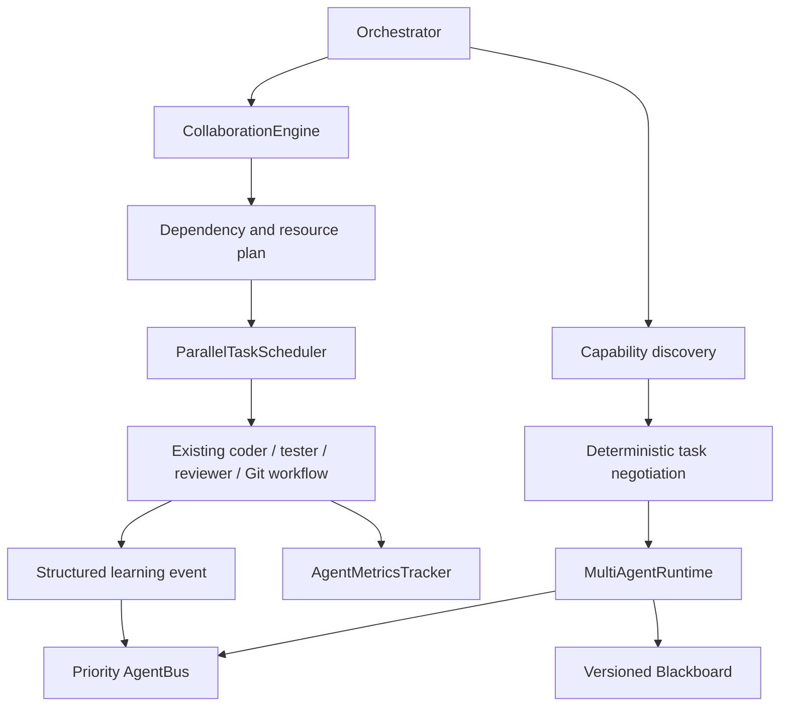

The message bus supports task requests/results, questions/answers, errors,
status, learning events, and system events. Inbox ordering is priority-first and
FIFO for ties; broadcasts and response correlation are available through the
typed message API. The blackboard provides copy-isolated reads and writes,
per-key owner locks, optimistic version checks, snapshots, and rollback.
Negotiation uses fixed weights and agent-ID tie breaks. Consensus and conflict
results include stable structured evidence.

The scheduler validates dependency DAGs before execution, respects declared
resources and their capacity limits, and returns results in task-ID order.
Parallel groups are only created for ready, dependency-independent tasks.
Orchestrator coordination remains sequential by default and continues to use
the established coder, tester, reviewer, and Git workflow; in v3.8 mode it
adds capability assignment metadata, completion events, and agent metrics.
Default orchestrator descriptors are assignment targets and do not introduce
new autonomous code execution handlers. Structured task outcomes and failure
categories are added to the existing `KnowledgeReasoner` source collection and
published as learning events; existing v3.7 learning hooks continue to record
the richer task reflection and implementation outcomes.

### Version 3.8 public APIs

| API | Purpose |
| :--- | :--- |
| `MultiAgentRuntime.register_agent()`, `.remove_agent()`, `.discover()`, `.dispatch()`, `.broadcast()`, `.get_status()` | Register and discover agents, negotiate tasks, route requests/events, and inspect status. `.dispatch(execute_handler=False)` assigns and queues work without invoking a handler. |
| `AgentBus.publish()`, `.broadcast()`, `.send_request()`, `.receive()`, `.acknowledge()`, `.subscribe()` | Route typed messages with priority ordering, acknowledgements, and correlation. |
| `Blackboard.read()`, `.write()`, `.lock()`, `.unlock()`, `.history()`, `.snapshot()`, `.rollback()` | Share versioned state with conflict detection and rollback. |
| `TaskNegotiationEngine.negotiate()` and `AgentCapabilityManager.discover()` / `.recommend()` | Score eligible agents using fixed weights, availability, history, and stable ties. |
| `MultiAgentCollaborationEngine.plan()`, `.execute()`, `.progress()`, `.notify_completion()` | Inspect dependencies, schedule tasks through the safe scheduler, and publish progress. |
| `ConflictResolutionEngine.detect_conflicts()` / `.resolve()` and `MultiAgentConsensusEngine.decide()` | Produce deterministic conflict outcomes and explainable approval decisions. |
| `ParallelTaskScheduler.schedule()` / `.safe_parallel_groups()` | Validate and execute dependency-safe task batches with resource limits. |
| `AgentMetricsTracker.record()`, `.get_metrics()`, `.all_metrics()` | Persist success, latency, review, defect, collaboration, and resource metrics under `memory/agent_metrics/`. |

Module-specific names are also available directly from their `core.*` modules.
The package root uses `MultiAgentConsensusEngine` and
`MultiAgentCollaborationEngine` aliases to avoid changing the existing
`ConsensusEngine` and `CollaborationEngine` exports.

Run the standard-library benchmark harness with:

```console
python benchmark_v38.py
```

It writes
[`memory/benchmarks/v38_multi_agent_results.json`](./memory/benchmarks/v38_multi_agent_results.json)
and appends a record to
[`memory/benchmarks/v38_benchmark_history.json`](./memory/benchmarks/v38_benchmark_history.json).
The report measures operation latencies, scheduler throughput/efficiency,
message throughput, a warm symbol-cache hit ratio, and traced peak allocation
for one local run. These values are descriptive microbenchmarks, not
repository-wide speedup or latency guarantees.

See [`v38_engineering_report.md`](./v38_engineering_report.md) for the detailed
message protocol, blackboard, negotiation, consensus, scheduling, integration,
benchmark methodology, and verified test results.

## 🏢 Version 3.9 — Opt-in Autonomous Engineering Organization

Version 3.9 adds an organization-management layer around the existing enterprise
models and Version 3.8 agent runtime. It manages teams and reporting hierarchy,
projects, epics, sprints, releases, resource reservations, task progress, risk,
release readiness, engineering metrics, adaptive dependency-safe backlog order,
and executive dashboard exports.

The new workflow is **opt-in**. Existing callers retain the single-agent
workflow by default. Enable the organization layer explicitly:

```python
from core.orchestrator import Orchestrator

orchestrator = Orchestrator(
    project_root=".",
    organization_mode=True,
)
```

When enabled, the orchestrator builds a project and team context, orders pending
work by priority while honoring dependencies, reserves a worker resource for
each task, records task and engineering metrics, and publishes an organization
dashboard. Code generation, testing, review, and Git operations continue to use
the established AutoDev pipeline. The legacy single-agent default is unchanged.

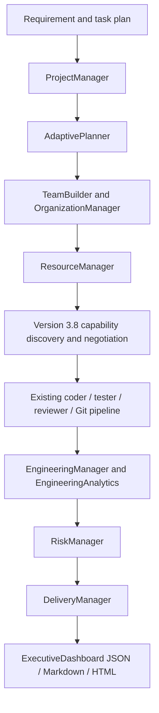

The organization hierarchy is a team-level reporting tree: teams can have
parent teams, declared capabilities, role assignments, member agents, lifecycle
state, and health derived from the runtime's availability status. Team building
selects capability matches deterministically, preferring historical success,
lower workload, higher agent priority, and then agent ID. Resource requests
share explicit capacities and are admitted by descending priority with stable
FIFO ties; releases promote queued requests without violating the capacity
limit.

### Version 3.9 APIs

| Component | Public API |
| :--- | :--- |
| `OrganizationManager` | `create_team()`, `remove_team()`, `assign_agent()`, `remove_agent()`, `team_status()`, `organization_summary()` |
| `ProjectManager` | `create_project()`, `create_epic()`, `create_sprint()`, `create_release()`, `project_dashboard()` |
| `ResourceManager` | `allocate()`, `release()`, `forecast()`, `resource_usage()` |
| `TeamBuilder` | `build_team()`, `recommend_agents()` |
| `EngineeringManager` | `record_task()`, `generate_report()`, `task_history()` |
| `RiskManager` | `analyze()` |
| `DeliveryManager` | `assess_release()`, `release_readiness()` |
| `EngineeringAnalytics` | `record()`, `metrics()`, `history()` |
| `AdaptivePlanner` | `order_backlog()`, `replan()` |
| `ExecutiveDashboard` | `build()`, `export_json()`, `export_markdown()`, `export_html()` |

The project manager reuses the established enterprise `Epic`, `SprintPlan`,
`ReleaseCandidate`, and enum models. The existing enterprise managers and
Version 3.8 scheduler/runtime remain available and unchanged; organization mode
adds lifecycle and status integration without changing legacy constructor
positions or default behavior.

### Version 3.9 benchmark artifacts

Run the standard-library local microbenchmark harness:

```console
python benchmarks/v39_benchmarks.py
```

The runner records 25 samples for organization creation, team formation, sprint
planning, resource allocation, risk analysis, analytics generation, and
dashboard generation. It writes
[`memory/benchmarks/v39_benchmark_results.json`](./memory/benchmarks/v39_benchmark_results.json),
[`memory/benchmarks/v39_benchmark_history.json`](./memory/benchmarks/v39_benchmark_history.json),
and [`memory/benchmarks/v39_performance_report.json`](./memory/benchmarks/v39_performance_report.json).
Values are local microbenchmark measurements, not performance guarantees or
comparisons against an earlier release.

See [`v39_engineering_report.md`](./v39_engineering_report.md) for the
architecture, integration details, measured latencies, and verification
results.

## Version 4.0 — Autonomous Software Engineering Intelligence

Version 4.0 adds an optional, deterministic evolution cycle that combines
engineering research, architecture and quality analysis, isolated experiments,
optimization recommendations, performance telemetry, and a software knowledge
graph. Existing task planning and orchestration remain the default; enable
evolution programmatically with `Orchestrator(evolution_mode=True)`.

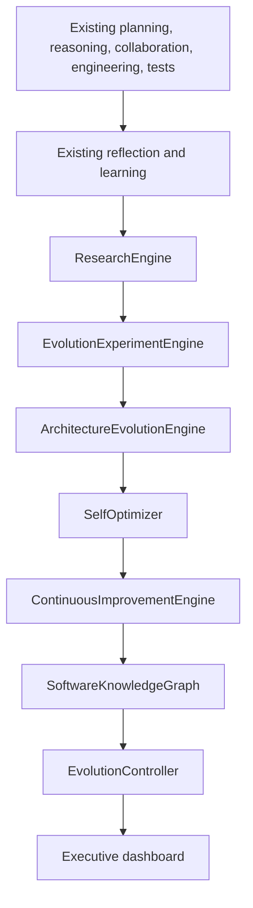

### Version 4.0 subsystems and APIs

| Component | Main public APIs | Purpose |
| :--- | :--- | :--- |
| `ResearchEngine` | `discover_problem()`, `generate_research_plan()`, `evaluate_results()`, `publish_findings()` | Rank evidence-backed engineering problems, compare candidate results, and persist stable findings. |
| `ArchitectureEvolutionEngine` | `analyze()` | Reuse repository analysis to report architectures, hotspots, dependency cycles, alternatives, and maintainability estimates. |
| `EvolutionExperimentEngine` | `create_experiment()`, `run()`, `compare()`, `rollback()` | Run repeated baseline/candidate measurements, compare statistically, and discard isolated experiment workspaces. The legacy `ExperimentEngine` API remains available. |
| `SelfOptimizer` | `optimize()` | Produce evidence-based planning, scheduling, prompting, reasoning, collaboration, learning, execution, and caching proposals without applying behavior-changing edits. |
| `CodeQualityEngine` | `analyze()` | Report complexity, maintainability, coupling, cohesion, duplication, possible dead code, and architecture violations using existing analyzers and the SymbolGraph. |
| `DesignPatternEngine` | `analyze()` | Detect selected patterns and anti-patterns from Python ASTs and recommend review/refactoring. |
| `PerformanceEvolutionEngine` | `capture()`, `analyze()` | Normalize CPU, peak memory, cache, and planning/scheduling/execution/learning telemetry into recommendations. |
| `ContinuousImprovementEngine` | `generate_roadmap()` | Merge research, architecture, performance, learning, reflection, analytics, and engineering recommendations into a deterministic priority-ranked roadmap. |
| `SoftwareKnowledgeGraph` | `add_repository()`, `add_artifact()`, `add_edge()`, `neighbors()`, `traverse()`, `shortest_path()`, `search()`, `export_json()` | Represent modules, classes, functions, dependencies, architecture, patterns, experiments, benchmarks, learning, and evolution history. |
| `EvolutionController` | `run_cycle()` | Coordinate the evolution subsystems, read learning and benchmark evidence, and publish one ordered cycle report. |

The knowledge graph sorts nodes, edges, and neighbors for deterministic output
and traversal. Each evolution cycle links its research finding, experiment,
architecture/pattern evidence, learning events, and benchmarks to the cycle
history node. The orchestrator reuses its incremental SymbolGraph, learning
engine, performance profiler, and executive dashboard rather than replacing
existing components.

Experiment evaluators are trusted Python callables. Each sample runs with its
own temporary working directory, which isolates candidate-created files but is
not an operating-system security sandbox. Rollback discards those workspaces
and clears any selected candidate; no candidate is automatically deployed.
Self-optimization is recommendation-only and leaves external behavior
unchanged.

### Version 4.0 benchmark artifacts

Run the standard-library benchmark harness:

```console
python benchmarks/v40_benchmarks.py
```

It records research planning, architecture analysis, experiment execution,
knowledge graph construction, optimization, and full evolution-cycle latency.
The five-iteration local run writes
[`memory/benchmarks/v40_benchmark_results.json`](./memory/benchmarks/v40_benchmark_results.json),
[`memory/benchmarks/v40_benchmark_history.json`](./memory/benchmarks/v40_benchmark_history.json),
and [`memory/benchmarks/v40_performance_report.json`](./memory/benchmarks/v40_performance_report.json).
These are small one-module microbenchmarks; timings vary with the host and do
not claim release-to-release performance gains.

See [`v40_engineering_report.md`](./v40_engineering_report.md) for the full
architecture, workflow, public API, benchmark measurements, compatibility, and
validation details.

## Engineering Memory Intelligence (V3.10)

The additive memory-intelligence layer supplies structured, persistent task
outcomes, searchable engineering experience, deterministic knowledge-graph
queries, ranked context, and evidence-backed recommendations. Enable it
explicitly with `Orchestrator(memory_mode=True)`; the default execution path and
existing constructor calls remain unchanged. Sensitive reasoning traces are
excluded from persisted records.

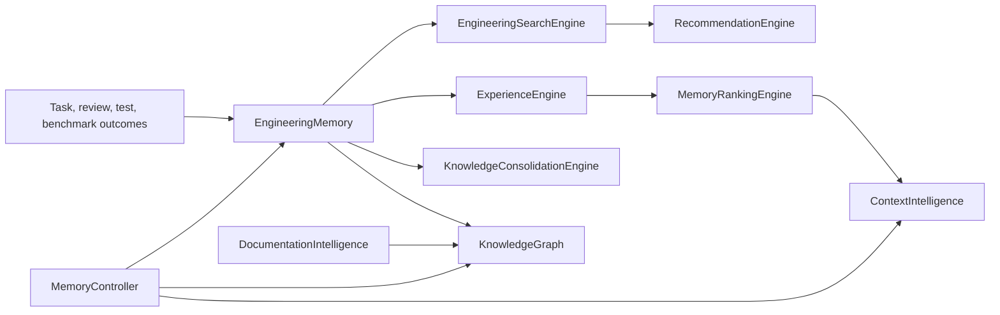

| Component | Public APIs | Role |
| :--- | :--- | :--- |
| `EngineeringMemory` | `store()`, `retrieve()`, `update()`, `search()`, `records()`, `forget()`, `summarize()` | Persistent structured records, backed by the existing `MemoryManager`. |
| `KnowledgeGraph` | `add_repository()`, `find_paths()`, `related_nodes()`, `dependency_graph()` | Deterministic traversal layered over the V4 `SoftwareKnowledgeGraph`. |
| `EngineeringSearchEngine` | `search()`, `similar()`, `history()`, `recommend()` | Search memory, graph entities, and dependency neighborhoods. |
| `ExperienceEngine` | `retrieve()`, `similar_tasks()`, `successful_patterns()`, `failure_lessons()` | Retrieve relevant prior work, including failures when requested. |
| `KnowledgeConsolidationEngine` | `consolidate()`, `deduplicate()` | Group recurring evidence without deleting source records. |
| `ContextIntelligence` | `build_context()`, `inject()` | Assemble bounded, ranked historical context for planning. |
| `MemoryRankingEngine` | `rank()`, `best_memories()` | Rank by recency, importance, similarity, success, confidence, and utility. |
| `RecommendationEngine` | `recommend()`, `recommend_for_task()` | Produce deduplicated recommendations with source evidence. |
| `DocumentationIntelligence` | `analyze()`, `search()`, `link_memories()` | Index Markdown sections and associate them with engineering records. |
| `MemoryController` | `record_task_outcome()`, `retrieve_context()`, `search()`, `status()`, `consolidate()` | Unified facade for orchestration and application clients. |

With memory mode enabled, prior outcomes are inserted into planning context;
task success/failure, changed files, test and review summaries, metrics,
recommendations, and architecture decisions are recorded. Learning, reasoning,
planning revision, collaboration, benchmarks, and the executive dashboard keep
their existing roles; memory adds a retrieval and persistence layer around
their structured outputs. Memory does not cause a candidate change to be
applied automatically.

Run the standard-library microbenchmark harness:

```console
python tests/benchmark_v310.py
```

The harness measures persistent storage, search, experience retrieval, context
assembly, ranking, graph traversal, consolidation, documentation analysis, and
an end-to-end memory cycle. Results are written to
[`memory/benchmarks/v310_benchmark_results.json`](./memory/benchmarks/v310_benchmark_results.json),
[`memory/benchmarks/v310_benchmark_history.json`](./memory/benchmarks/v310_benchmark_history.json),
and [`memory/benchmarks/v310_performance_report.json`](./memory/benchmarks/v310_performance_report.json).
These local microbenchmarks are host-dependent and are not performance
guarantees. See [`v310_engineering_report.md`](./v310_engineering_report.md)
for subsystem architecture, validation, compatibility, and benchmark details.

## Tool Intelligence and Environment Awareness (V3.11)

V3.11 adds a deterministic, read-only environment intelligence layer for
repository structure, local Git history, dependencies, APIs, documentation,
and available developer tools. It does not execute tools or modify the
repository. Opt in with `Orchestrator(environment_mode=True)`; the default
orchestration path remains unchanged. Environment findings are available in
the orchestration context and executive dashboard.

```mermaid
flowchart LR
    Environment[EnvironmentAnalyzer] --> Controller[EnvironmentController]
    Repository[RepositoryIntelligence] --> Controller
    Dependencies[DependencyIntelligence] --> Controller
    Git[GitIntelligence] --> Controller
    Tools[ToolRegistry] --> Selection[ToolSelector]
    APIs[APIDiscoveryEngine] --> Controller
    Docs[DocumentationIntelligence V2] --> Controller
    Selection --> Planner[ToolExecutionPlanner]
    Planner --> Controller
    Controller --> Report[Environment awareness report]
    Controller --> Orchestrator[Optional environment_mode]
    Orchestrator --> Dashboard[Executive dashboard]
```

| Component | Public APIs | Role |
| :--- | :--- | :--- |
| `ToolRegistry` | `register()`, `discover()`, `get()`, `list_tools()`, `lookup()` | Deterministic registration and local PATH discovery with capability/version metadata. |
| `ToolSelector` | `select()`, `rank()`, `recommend()` | Ranks available, compatible tools using task fit, platform, language, confidence, and historical outcomes. |
| `EnvironmentAnalyzer` | `analyze()` | Reports host, Python, tools, build and package managers, CI, Docker/container, workspace layout, and resources. |
| `RepositoryIntelligence` | `analyze()` | Extends the existing repository analyzer with package ownership, dependency/build graphs, cycles, and health. |
| `GitIntelligence` | `analyze()` | Reads bounded local commits, branches, recent file changes, failure areas, ownership, and hotspots. |
| `DependencyIntelligence` | `analyze()` | Uses existing dependency scanners and analyzers to summarize manifests, imports, conflicts, risk, and upgrade opportunities. |
| `APIDiscoveryEngine` | `discover()`, `search()` | Finds REST/OpenAPI (JSON and YAML), GraphQL, Python, CLI, and configuration interfaces. |
| `DocumentationIntelligence` | `analyze()`, `analyze_v2()`, `search()`, `link_memories()` | Indexes Markdown sections plus README/changelog/architecture summaries, API metadata, and cross-references. |
| `ToolExecutionPlanner` | `plan()` | Produces an ordered, deterministic tool plan; it never executes the plan. |
| `EnvironmentController` | `analyze()`, `status()` | Combines environment, repository, dependency, Git, tool, API, and documentation reports. |

The opt-in orchestration path shares the already incrementally indexed symbol
graph with environment analysis and supplies the report to task planning. It
does not change the existing execution, testing, learning, or memory defaults.
Tool recommendations and execution plans are advisory only; actions that
execute or modify files remain subject to the existing orchestration flow.

Generate local V3.11 benchmark artifacts with:

```console
python tests/benchmark_v311.py
```

The harness records environment scanning, repository analysis, dependency and
Git analysis, tool selection, API discovery, and end-to-end report generation
under `memory/benchmarks/v311_benchmark_results.json`,
`memory/benchmarks/v311_benchmark_history.json`, and
`memory/benchmarks/v311_performance_report.json`. Measurements are local and
host-dependent. See [`v311_engineering_report.md`](./v311_engineering_report.md)
for architecture, workflow, APIs, benchmark values, compatibility, and
validation results.
