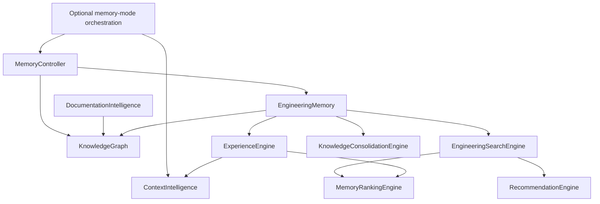

# AutoDev V3.10 Engineering Memory Intelligence Report

## Overview

V3.10 adds an optional structured engineering-memory layer to AutoDev. It
reuses the existing `MemoryManager` persistence format and the V4
`SoftwareKnowledgeGraph`; it does not replace task planning, learning,
reasoning, collaboration, analytics, benchmarks, or orchestration. The
orchestrator enables it only when constructed with `memory_mode=True`.

## Architecture

## Subsystems and public APIs

| Subsystem | APIs | Implementation |
| :--- | :--- | :--- |
| Engineering memory | `store()`, `retrieve()`, `update()`, `search()`, `records()`, `forget()`, `summarize()` | Structured JSON records persisted through `MemoryManager`, deterministic IDs, task tags, and sensitive reasoning-key filtering. |
| Knowledge graph | `add_repository()`, `find_paths()`, `related_nodes()`, `dependency_graph()` | Extends the established typed graph, BFS, and symbol graph without a new graph dependency. |
| Engineering search | `search()`, `similar()`, `history()`, `recommend()` | Combines exact lexical/keyword search, record ranking, and graph dependency lookup. |
| Experience retrieval | `retrieve()`, `similar_tasks()`, `successful_patterns()`, `failure_lessons()` | Reuses the search and ranking layers to find relevant task outcomes. |
| Knowledge consolidation | `consolidate()`, `deduplicate()` | Stable fingerprints and summaries; original source records remain intact. |
| Context intelligence | `build_context()`, `inject()` | Bounded context bundles with source IDs; excludes private reasoning traces. |
| Memory ranking | `rank()`, `best_memories()` | Deterministic weighted ranking for recency, importance, similarity, success rate, confidence, and utility. |
| Recommendations | `recommend()`, `recommend_for_task()` | Deduplicated suggestions paired with source record evidence. |
| Documentation intelligence | `analyze()`, `search()`, `link_memories()` | Markdown heading extraction, stable section hashes, local documentation search, and memory edges. |
| Memory controller | `record_task_outcome()`, `record()`, `retrieve_context()`, `search()`, `status()`, `consolidate()` | Facade that wires shared memory, graph, ranking, search, experience, context, recommendations, consolidation, and docs. |

## Evolution and retrieval workflow

When enabled, orchestration retrieves a bounded memory context from the
current requirement and phase before task planning. Completed or failed
execution outcomes are persisted after the task pipeline. Records capture
task identity and description, success, changed files, test and review
summaries, retry and execution metrics, recommendations, and available
architecture decisions. Structured reasoning summaries are accepted only from
explicit summary fields; private reasoning/chain-of-thought keys are filtered.

The layer then supports search and ranking of successful approaches and
failures, bounded context construction, recommendation retrieval, duplicate
knowledge consolidation, documentation-to-memory links, and a deterministic
graph status view. Failure to persist a record is reported through the
orchestrator logger and does not change the task's success result.

## Compatibility

`memory_mode` is an optional final `Orchestrator` parameter with a default of
`False`. Existing positional and keyword construction remains valid, and the
default execution path does not instantiate or read the memory controller.
All persistent storage uses the existing standard-library memory manager.
The new graph wraps/reuses the existing software graph and symbol graph.

## Benchmarks

The benchmark harness is `tests/benchmark_v310.py`; it writes:

- `memory/benchmarks/v310_benchmark_results.json`
- `memory/benchmarks/v310_benchmark_history.json`
- `memory/benchmarks/v310_performance_report.json`

It measures memory storage, engineering search, experience retrieval, context
assembly, ranking, knowledge-graph traversal, consolidation, documentation
analysis, and an end-to-end memory cycle. Timings are local
temporary-workspace microbenchmarks and are not release-to-release claims.

The latest five-iteration local run reported these mean latencies:

| Measurement | Mean |
| :--- | ---: |
| Memory storage | 0.000399 s |
| Engineering search | 0.001165 s |
| Experience retrieval | 0.001657 s |
| Context assembly | 0.001358 s |
| Memory ranking | 0.000351 s |
| Knowledge-graph traversal | 0.000023 s |
| Knowledge consolidation | 0.000238 s |
| Documentation analysis | 0.000300 s |
| End-to-end memory cycle | 0.001897 s |

## Validation

The V3.10-specific test files cover structured persistence and filtering,
graph traversal, search, experience retrieval, consolidation, context bounds,
ranking, recommendations, documentation indexing, controller behavior,
benchmark artifact output, and optional orchestrator integration. Focused
validation also covers the existing memory manager, V3 orchestrator, V4
integration, and incremental-development regression tests: **79 passed**.
After the code, documentation, and benchmark artifacts were complete, the
complete repository suite was run exactly once: **2,453 passed**, with zero
failures, errors, or collection failures.
