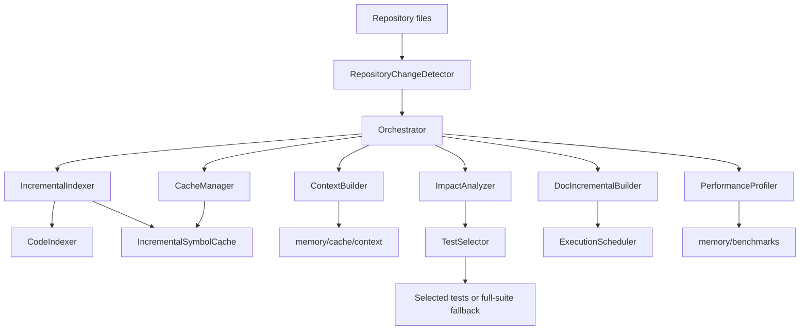

# AutoDev 3.6.1 Engineering Report

## Release scope

Version 3.6.1 stabilizes the incremental development workflow and its legacy
compatibility surface. It adds no Version 3.7 functionality. Cache data remains
disposable: a missing, incompatible, malformed, or checksum-invalid symbol cache
is treated as a cache miss and rebuilt from source.

## Architecture



The repository detector snapshots file hashes and classifies additions,
modifications, deletions, renames, tests, and documentation. The orchestrator
shares that snapshot with indexing and context building, runs impact analysis
before conservative test selection, updates only managed documentation sections,
and records duration/cache telemetry. Dependency-aware scheduled work remains
ordered; only independent tasks can execute concurrently.

## Cache and compatibility behavior

`IncrementalSymbolCache` writes deterministic JSON and a SHA-256 checksum of the
canonical graph payload. It validates the cache version and required graph
collections before import. Missing, old/future-version, malformed, partial, or
checksum-invalid entries miss safely; cache consumers then re-index source files.
The loader still accepts structurally complete version-1 cache files without a
checksum to retain compatibility with caches written before checksum support.
Unchanged-file hash bookkeeping is released immediately after a cache hit.

The compatibility repair restores the legacy agent module paths and exported
enums/classes, and retains prior constructor and test-runner call behavior.
Subprocess validation commands expressed as `pytest ...`, `python -m pytest ...`,
or `python3 -m pytest ...` are normalized to the active Python interpreter.

## Public APIs

| Component | Public surface | Persisted data |
| --- | --- | --- |
| `RepositoryChangeDetector` | `snapshot()`, `detect()`, `save()`, `load()` | `memory/cache/repository_changes/` |
| `IncrementalSymbolCache` | `load()`, `save()`, `has_changed(file)`, `update(file)`, `invalidate(file)`, `statistics()` | `memory/cache/symbol_graph/` |
| `IncrementalIndexer` | `index_project()`, `update_files()`, `get_graph()`, `statistics()` | `memory/cache/code_index/` and existing index |
| `ContextBuilder` | Existing `build()`/`build_context()` and workspace scan APIs | `memory/cache/context/` |
| `DocIncrementalBuilder` | `update_document()`, `update_documents()`, `document_kind()` | Managed document sections |
| `TestSelector` | `select_tests()`, `select()` | None |
| `ExecutionScheduler` | `add_task()`, `execute()` | None |
| `CacheManager` | `clear()`, `repair()`, `verify()`, `stats()` | Cache registry/directories |
| `PerformanceProfiler` | `profile_subsystem()`, `record_duration()`, `record_memory_usage()`, `save_report()` | `memory/benchmarks/` |

All new subsystems use Python standard-library facilities. Test selection falls
back to the complete suite if impact confidence is low. Injected legacy test
runners that do not accept selected test paths continue to receive their
original full-suite call.

## Benchmark method and results

Reproduce the measurements with `python benchmark_v36_1.py`. The harness creates
a temporary synthetic repository with 1,000 Python source files containing five
symbols and a 4 KB metadata literal each, 500 test files, and a 100-section
managed document. It measures
forced full indexing versus warm no-change indexing; full standalone graph
generation versus an isolated one-file graph update; cold versus hash-backed
warm context scans; whole-document rewrite versus unchanged managed-section
updates; and cold versus warm `Orchestrator.run()` with an injected no-op task
planner. Orchestration measurements include no task execution. Wall-clock
comparisons use medians; the raw samples and environment are recorded in
`memory/benchmarks/v36_1_benchmark_results.json`.

| Measurement | Baseline | Incremental/warm | Improvement |
| --- | ---: | ---: | ---: |
| Repository indexing | Forced full-index median (5 samples) | Warm index median (10 samples) | 93.26% faster |
| Symbol graph generation | Full graph parse median (5 samples) | One-file cached graph update median (10 samples) | 99.79% faster |
| Context building | Cold cache median (5 samples) | Warm cache median (5 samples) | 71.10% faster |
| Documentation update | Full rewrite median (50 samples) | Unchanged managed-section update median (50 samples) | 87.77% faster |
| Development iteration | Cold no-op orchestration (1 sample) | Warm no-op orchestration median (3 samples) | 81.53% faster |
| Warm cache hit ratio | 15,000 warm file observations | 15,000 hits, 0 misses | 100% |
| Cache bookkeeping overhead | Estimated 406,289 retained Python bytes | 8,621,289-byte SymbolGraph object model | 4.71% |
| Test selection | 500 available test files | 1 selected test file | 99.8% fewer files |

The cache-overhead figure is an estimate of retained Python cache bookkeeping
and per-file hashes relative to the in-memory graph model. It excludes
interpreter allocator overhead; it is not a process RSS measurement. Peak
`tracemalloc` indexing allocations were 28,143,557 bytes cold and 3,085,702
bytes warm in the recorded run. The full cache hit/miss ratio also includes
intentional cold/forced rebuilds; the warm-only ratio above isolates the ten
no-change iterations. Environment and synthetic workload limit generalization
of every speedup result.

All requested benchmark categories now have measured output: standalone symbol
graph generation, cold/warm cache runs, hit/miss and average rebuild time,
incremental execution duration, no-op orchestration duration, cache bookkeeping
estimate, and test discovery. `memory/benchmarks/benchmark_history.json`,
`v36_1_benchmark_history.json`, and `performance_report.json` contain the
generated history and summaries; these are benchmark samples, not service-level
guarantees.

## Regression and stress validation

`tests/test_incremental_361.py` covers deterministic change classification,
renames/deletions, incremental symbol updates, warm cache hits, missing/corrupt/
partial/old/future-version cache recovery, context invalidation, managed
documentation, concurrent independent document writes, selection fallback,
scheduler dependency/error behavior, cache repair/versioning, profiler output,
CLI compatibility, and legacy orchestrator test-runner signatures. Its large
repository case indexes 1,001 source files plus 501 tests, builds a dependency
graph, then exercises rename and deletion recovery and selected-test discovery.

The full repository suite was run with:

```console
python -m pytest tests/ -q --tb=short
```

**Final result: 2,360 passed, 0 failed, 0 errors, 0 collection failures.**

