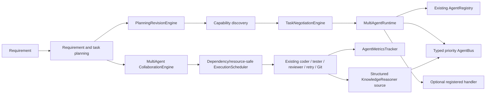
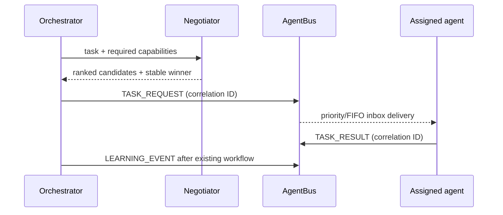

# AutoDev Version 3.8 Engineering Report

## Status and scope

Version 3.8 adds an opt-in deterministic multi-agent collaboration layer. The
default `Orchestrator(coordination_mode="single")` path remains the existing
single-agent workflow. In collaborative mode, task assignment and structured
outcome sharing are added while the existing coder, tester, reviewer, retry,
and Git pipeline continues to perform the work.

Implementations reuse AutoDev's `AgentRegistry`, `PlanningRevisionEngine`,
`ExecutionScheduler`, and v3.7 `KnowledgeReasoner`. Public v3.8 module names are
available under `core.*`; package-root aliases avoid replacing the existing
`ConsensusEngine` and `CollaborationEngine` exports.

## Architecture

The opt-in orchestrator can add assignment metadata to task context, but default
role descriptors are queue-only; the legacy task workflow remains responsible
for code generation and validation. Applications can explicitly use
`MultiAgentRuntime.dispatch(..., execute_handler=True)` when a registered
handler is intended to execute work.

### Communication protocol

`AgentBus` provides `TASK_REQUEST`, `TASK_RESULT`, `QUESTION`, `ANSWER`, `ERROR`,
`STATUS`, `LEARNING_EVENT`, and `SYSTEM_EVENT` message kinds. A message includes
an ID, sender, receiver, payload, integer priority, optional correlation ID,
acknowledgement state, and monotonic sequence number. Each inbox is a priority
queue: higher priority is delivered first and equal-priority messages are
delivered FIFO. Subscribers receive deep-copied messages; `send_request()`
waits up to the supplied timeout for a correlated `TASK_RESULT`. History and
acknowledgements are available for inspection.

### Blackboard, assignment, and decisions

`Blackboard` holds deep-copy-isolated values with monotonically increasing
per-key versions, optimistic `expected_version` checks, owner locks, snapshots,
history, and rollback as a new version. `TaskNegotiationEngine` filters
capability-eligible and available agents, then applies fixed weights for
capability match, historical success, workload, runtime, confidence, and
reliability. Ties are broken by ascending agent ID. `ConflictResolutionEngine`
detects overlapping file/resource assignments and contradictory proposals;
policies are explicit and deterministic. `MultiAgentConsensusEngine.decide()`
returns an approval outcome, vote counts, confidence, strategy, reason, and
sorted evidence. Proposal IDs for direct decisions are sequence-unique, so
repeated calls do not collide with prior decisions.

### Dependency-safe scheduling

`ParallelTaskScheduler` delegates execution to the existing
`ExecutionScheduler`. It validates unknown dependencies and cycles before
starting work, schedules ready tasks in stable ID order, honors resource
capacities, propagates failures, and returns results ordered by task ID.
`PlanningRevisionEngine.optimize()` exposes dependency-safe parallel groups;
the orchestrator does not use those groups to change its legacy sequential
execution behavior.

## Public APIs

| Module / API | Description |
| :--- | :--- |
| `core.multi_agent_runtime.MultiAgentRuntime.register_agent()` / `.remove_agent()` | Register agents, handlers, and capabilities; remove registry and inbox state. |
| `MultiAgentRuntime.discover()` / `.dispatch()` / `.broadcast()` / `.get_status()` | Capability lookup, deterministic assignment, optional handler execution, event delivery, and health/status inspection. |
| `core.agent_bus.AgentBus.publish()` / `.broadcast()` / `.send_request()` / `.receive()` / `.acknowledge()` / `.subscribe()` | Typed priority messaging, request correlation, subscriptions, inbox delivery, and audit history. |
| `core.blackboard.Blackboard.read()` / `.write()` / `.lock()` / `.unlock()` / `.history()` / `.snapshot()` / `.rollback()` | Versioned, locked shared state with conflict detection. |
| `core.capability_manager.AgentCapabilityManager.register()` / `.discover()` / `.recommend()` | Track and rank skills, languages, domains, reliability, accuracy, and preferred workload. |
| `core.task_negotiation.TaskNegotiationEngine.negotiate()` | Return a stable score breakdown and assignment decision. |
| `core.collaboration_engine.CollaborationEngine.plan()` / `.execute()` / `.progress()` / `.notify_completion()` / `.synchronize()` | Plan, execute dependency-aware work, track task progress, and signal completion. |
| `core.conflict_resolution.ConflictResolutionEngine.detect_conflicts()` / `.resolve()` | Identify and resolve file, resource, or decision conflicts using an explicit policy. |
| `core.consensus_engine.ConsensusEngine.decide()` | Run an explainable vote using supported legacy and v3.8 consensus strategies. |
| `core.parallel_scheduler.ParallelTaskScheduler.schedule()` / `.safe_parallel_groups()` | Safely execute tasks and inspect conflict-safe plan groups. |
| `core.agent_metrics.AgentMetricsTracker.record()` / `.get_metrics()` / `.all_metrics()` | Persist aggregate quality, reliability, time, collaboration, and resource metrics in `memory/agent_metrics/`. |

At package root, aliases `MultiAgentCollaborationEngine`,
`MultiAgentConsensusEngine`, and `MultiAgentConsensusResult` are used to preserve
older unqualified exports.

## Determinism, compatibility, and learning

- Agent ranking and schedule submission use stable ordering and explicit ties.
- No chain-of-thought is stored or emitted. Learning records contain task
  identifiers, title/description, outcome, affected file paths, test pass rate,
  review score, retry count, and failure category only.
- Collaborative orchestration leaves the single-mode default intact. When
  enabled, it queues an assignment without invoking an agent handler, then runs
  the existing task pipeline. A structured task outcome is added to
  `KnowledgeReasoner` for later task context and broadcast as a `LEARNING_EVENT`.
- The existing v3.7 learning hook remains responsible for richer reflection and
  implementation records. V3.8 does not claim that every agent consumes or
  autonomously improves from every broadcast.
- The scheduler and runtime use only Python standard-library concurrency and
  synchronization primitives.

## Benchmark results

Command: `python benchmark_v38.py --iterations 30`. The script writes
[`memory/benchmarks/v38_multi_agent_results.json`](./memory/benchmarks/v38_multi_agent_results.json)
and appends to
[`memory/benchmarks/v38_benchmark_history.json`](./memory/benchmarks/v38_benchmark_history.json).
The following are measurements from this workspace's single local run; they
are not service-level guarantees.

| Measurement | Result |
| :--- | ---: |
| Agent dispatch latency, mean / p95 | 0.627 ms / 0.834 ms |
| Negotiation latency, mean / p95 | 0.111 ms / 0.139 ms |
| Collaboration planning latency, mean / p95 | 0.290 ms / 0.543 ms |
| Consensus latency, mean / p95 | 0.191 ms / 0.225 ms |
| Blackboard read/write latency, mean / p95 | 0.028 ms / 0.038 ms |
| Message throughput | 6,138.61 messages/s over 300 publishes |
| Scheduler synthetic run | 30 independent 1 ms tasks; 0.0322 s serial vs 0.0120 s parallel |
| Scheduler synthetic speedup / worker efficiency | 2.68x / 0.67 |
| Warm incremental symbol-cache hits | 20/20; 100% hit ratio, 0 misses |
| `tracemalloc` peak allocation during benchmark | 1,063,694 bytes |

These values do not establish a before/after speedup for a production workload.
No v3.8 baseline exists for these multi-agent operations; peak traced allocation
is not process RSS or retained per-agent memory. The scheduler test uses
independent synthetic tasks, and its result depends on runtime and host load.

## Validation

The focused v3.8 and compatibility group completed with **58 passed**. The
incremental workflow detected file changes, updated only changed source files
in the SymbolGraph index, generated impact reports, and invoked `TestSelector`.
For this repository the selector returned roughly 195–199 tests in recent
cycles; focused validation was used after the selected run identified and
corrected a new consensus assertion issue.

The single required final whole-repository test run was performed after
implementation and documentation were complete.

### Final repository test run

Command: `.venv/bin/python -m pytest tests/`

**Result: 2,393 passed in 136.94 seconds. Zero failures, errors, import errors,
or collection failures.**
