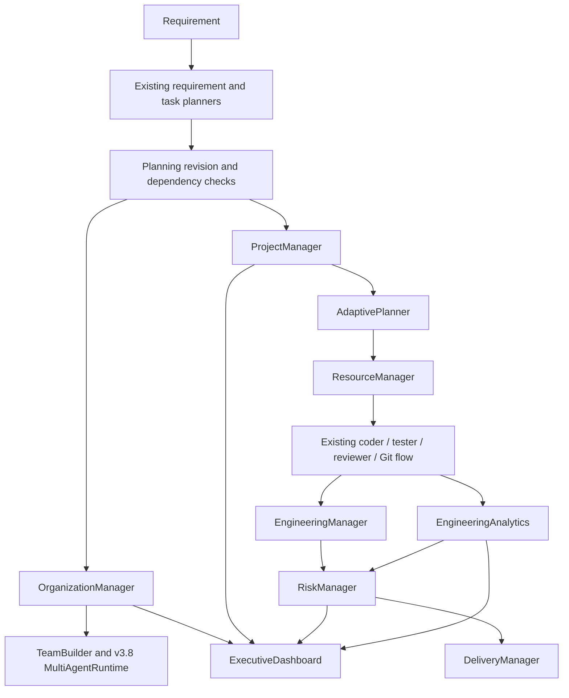

# AutoDev Version 3.9 Engineering Report

## Release objective

Version 3.9 adds an opt-in autonomous engineering organization layer to the
existing AutoDev workflow. It preserves the default single-agent execution
path and reuses the enterprise data models and Version 3.8 multi-agent runtime.
The implementation uses the Python standard library.

## Architecture

### Organization and team hierarchy

`OrganizationManager` owns a deterministic team registry. Each team has a
stable ID, declared capabilities, agent membership, optional role assignments,
an optional parent team, and an active status. Parent links establish team
reporting hierarchy; removal refuses to orphan children unless cascading removal
is explicitly requested. If attached to the v3.8 runtime, team health reflects
registered member availability and workload.

`TeamBuilder` maps engineering roles to capability sets and ranks candidate
agents by availability, recorded success rate, workload, configured priority,
and agent ID. Each criterion and tie-break is stable. No language model or
random selection participates in organization, assignment, or planning logic.

## Project lifecycle and planning

`ProjectManager` creates projects, enterprise-model `Epic` instances,
`SprintPlan` records, and `ReleaseCandidate` records. Generated IDs follow
insertion order, sprint date offsets are fixed relative to project sprint
number, and release gates begin closed unless explicit gate values are given.
Backlog items can be updated as the existing orchestrator completes work.

`AdaptivePlanner` prioritizes ready tasks by ascending priority value and then
task ID. It only releases a task after its listed dependencies are complete or
earlier in the resulting topological sequence. It rejects duplicate IDs,
unresolved dependencies, and cycles rather than silently creating an unsafe
order.

## Resource allocation

`ResourceManager` provides capacity-limited resource allocations for CPU,
memory, workers, and caller-defined resources. Requests receive stable
allocation IDs; capacity shortages enter a priority queue, ordered by descending
priority and insertion sequence. Releasing an allocation promotes queued work
without exceeding capacity. The orchestrator reserves and releases a worker for
each organization-mode task. This is resource accounting; it does not claim to
run the existing sequential coder pipeline concurrently.

## Risk, delivery, and analytics

`RiskManager` evaluates explicit schedule variance, architecture-risk score,
technical-debt count, dependency bottlenecks, quality signals, and resource
forecasts. It returns risks in severity/category order with a deterministic
mitigation action for each identified risk.

`DeliveryManager` treats missing quality gates as false and includes unresolved
risks as release blockers. Its readiness confidence is based on the proportion
of required gates passed, adjusted by unresolved risks.

`EngineeringManager` tracks task status, quality scores, review duration,
blocked work, and project/team status snapshots. `EngineeringAnalytics`
persists engineering events beneath `memory/engineering_metrics/` and derives
velocity, throughput, lead time, cycle time, review duration, defect escape,
deployment readiness, deployment count, and completion rate.

## Executive dashboard exports

`ExecutiveDashboard` aggregates organization, project, release, risk,
performance, learning, and benchmark sections. It exports sorted JSON,
Markdown, and HTML; HTML content is escaped. The pre-existing
`core.enterprise.executive_dashboard.ExecutiveDashboard` API remains unchanged.

## Orchestrator integration and compatibility

The `Orchestrator` constructor adds `organization_mode=False` at the end of its
existing parameter list, along with optional subsystem injection parameters.
When false, organization subsystems are not created and the existing default
execution behavior remains active. When true, the workflow:

1. Builds or reuses a managed project, epic, sprint, release, and engineering
   team.
2. Adds planned tasks to the project backlog and orders pending work with
   dependency-safe priority.
3. Uses the existing v3.8 runtime for capability discovery and assignment.
4. Accounts for worker allocation and records task outcomes/engineering metrics.
5. Generates risk, release-readiness, engineering, and executive dashboard
   state.

The existing enterprise organization, engineering, sprint, release, and
executive dashboard modules remain intact. Existing positional constructor
parameters and default orchestration mode are preserved.

## Public APIs

| Component | Methods |
| :--- | :--- |
| `OrganizationManager` | `create_team`, `remove_team`, `assign_agent`, `remove_agent`, `team_status`, `organization_summary` |
| `ProjectManager` | `create_project`, `create_epic`, `create_sprint`, `create_release`, `project_dashboard` |
| `ResourceManager` | `allocate`, `release`, `forecast`, `resource_usage` |
| `TeamBuilder` | `build_team`, `recommend_agents` |
| `EngineeringManager` | `record_task`, `generate_report`, `task_history` |
| `RiskManager` | `analyze` |
| `DeliveryManager` | `assess_release`, `release_readiness` |
| `EngineeringAnalytics` | `record`, `metrics`, `history` |
| `AdaptivePlanner` | `order_backlog`, `replan` |
| `ExecutiveDashboard` | `build`, `export_json`, `export_markdown`, `export_html` |

All subsystem classes are importable directly from their `core.*` module.
Version 3.9 does not rename the legacy enterprise manager classes.

## Benchmarks

The standard-library harness is `benchmarks/v39_benchmarks.py`. It executes 25
iterations for each operation. The measured means from the latest local run:

| Measurement | Mean (seconds) | Iterations |
| :--- | ---: | ---: |
| Organization creation | 0.00000074 | 25 |
| Team formation | 0.00011673 | 25 |
| Sprint planning | 0.00001834 | 25 |
| Resource allocation/release | 0.00001411 | 25 |
| Risk analysis | 0.00000760 | 25 |
| Analytics generation | 0.00000764 | 25 |
| Dashboard generation | 0.00000823 | 25 |

Raw measurements are persisted at
[`memory/benchmarks/v39_benchmark_results.json`](./memory/benchmarks/v39_benchmark_results.json)
and appended to
[`memory/benchmarks/v39_benchmark_history.json`](./memory/benchmarks/v39_benchmark_history.json).
[`memory/benchmarks/v39_performance_report.json`](./memory/benchmarks/v39_performance_report.json)
contains the current report. These are local microbenchmarks of small in-memory
workloads; they are machine/load dependent and are not an end-to-end
orchestration comparison or a claimed release-to-release speedup.

## Tests and verification

During implementation the repository change detector and incremental indexer
were run on each code batch. Impact analysis and `TestSelector` identified the
affected tests; focused tests were run instead of the complete suite during
development.

Focused v3.9 and backward-compatibility validation: **46 passed**. It covered
all new manager tests, the opt-in organization orchestration path, benchmark
artifact shape, v3.6 orchestration regression tests, v3.8 orchestrator learning
regressions, and v3 orchestrator behavior.

The one final full repository test run completed after documentation and
benchmark artifacts were finalized: **2,420 passed in 138.41 seconds**. There
were no failures, errors, or collection failures.
