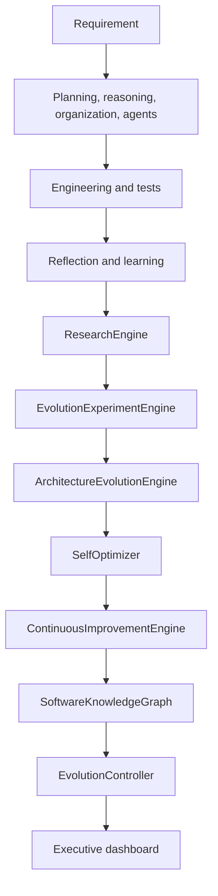

# AutoDev Version 4.0 Engineering Report

## Objective and compatibility

Version 4.0 adds an opt-in software-engineering evolution cycle on top of the
Version 3.9 organization and Version 3.6.1 incremental development layers.
Existing planners, agents, orchestration APIs, and the legacy scientific
`ExperimentEngine` remain available. `Orchestrator` keeps `evolution_mode=False`
by default; existing executions do not run the V4 cycle or alter their
dashboard output.

The new subsystems use Python standard-library facilities and reuse existing
`RepositoryAnalyzer`, `ComplexityAnalyzer`, `DuplicationDetector`,
`SymbolGraph`, statistical analysis, learning, performance profiling, and
executive dashboard components.

## Architecture and workflow

The existing task lifecycle remains unchanged when evolution mode is disabled.
When enabled, the orchestrator runs an evolution cycle at its existing
dashboard/finalization points and publishes the cycle report in the executive
dashboard. It passes the current incremental SymbolGraph, learning events,
analytics, and performance report into the controller.

## Subsystems

### Autonomous research

`ResearchEngine.discover_problem()` selects the highest-ranked problem from
deterministically sorted evidence. `generate_research_plan()` returns a stable
plan ID, goal, baseline, alternative list, metric, and comparison criteria.
`evaluate_results()` validates and summarizes candidate measurements with the
existing statistical analyzer. `publish_findings()` assigns stable IDs and
atomically persists findings under the configured research storage directory;
subsequent engine instances reload and extend that history.

### Architecture evolution and code intelligence

`ArchitectureEvolutionEngine.analyze()` delegates repository inventory,
hotspot, architecture, dependency-cycle, and dead-code discovery to
`RepositoryAnalyzer`, then provides stable recommendations and maintainability
estimates for current and simplified boundaries.

`CodeQualityEngine.analyze()` reuses complexity and duplication analyzers and
the optional incremental SymbolGraph. It reports complexity, maintainability,
coupling, cohesion, duplication, dead-code candidates, architecture violations,
per-file metrics, and recommendations. `DesignPatternEngine.analyze()` performs
deterministic AST recognition for selected patterns and flags anti-patterns
such as bare exception handlers, long functions, and god classes.

### Autonomous experiments

`EvolutionExperimentEngine.create_experiment()` records a baseline runner and
named candidate runners. `run()` measures repeated samples in separate
temporary workspaces, rejects invalid/non-finite measurements, and records
explicit failure state before propagating runner errors. `compare()` applies
the existing two-sample statistical test and selects only statistically
significant improvements. `rollback()` clears the selected candidate and
discards experiment state. The previous staged and scientific
`ExperimentEngine` public API is preserved.

**Execution boundary:** experiment runners are trusted callables, not
untrusted code. Temporary directories isolate filesystem artifacts created
inside the supplied workspace but do not provide process, network, or operating
system sandboxing. The engine does not deploy or apply candidate changes.

### Self-optimization and performance evolution

`SelfOptimizer.optimize()` proposes behavior-preserving investigations across
planning, scheduling, prompting, reasoning, collaboration, learning,
execution, and caching. It does not mutate AutoDev's runtime or external
behavior.

`PerformanceEvolutionEngine.capture()` records process CPU and peak RSS where
the platform provides the standard-library `resource` module, optional cache
statistics, and stage metrics. `analyze()` normalizes planning, scheduling,
execution, learning, and cache evidence and produces prioritized profiling
recommendations.

### Continuous improvement roadmap

`ContinuousImprovementEngine.generate_roadmap()` combines recommendations from
research, architecture, performance, learning, reflection, analytics, and
engineering. Duplicate titles are merged, evidence and source names are
sorted, priorities are ranked, and IDs are stable.

### Software knowledge graph

`SoftwareKnowledgeGraph.add_repository()` imports module, class, function,
definition, and dependency nodes/edges from the incremental SymbolGraph and
can add architecture and pattern evidence. `add_artifact()` supports research,
experiment, benchmark, learning, and evolution records. Nodes and edges are
sorted during export; `neighbors()`, breadth-first `traverse()`, and
`shortest_path()` use stable tie-breaking. Returned node data is copied so
callers cannot mutate graph state through a query result.

Each evolution cycle links the current research finding, optional experiment,
learning events, benchmark evidence, architecture records, and pattern records
to its evolution node.

### Evolution controller and benchmarks

`EvolutionController.run_cycle()` runs research, experiments (when runners
are supplied), architecture analysis, quality/pattern analysis, performance
recommendation, learning aggregation, optimization, roadmap generation, graph
update, and cycle publication in a fixed order. It accepts existing benchmark
telemetry through observations and can also consume a benchmark engine's
`get_scorecard()` or `generate_report()` result.

The repeatable benchmark harness is `benchmarks/v40_benchmarks.py`. It writes
raw results, appended history, and a performance report beneath
`memory/benchmarks/`.

Five-iteration local results on the one-module benchmark project:

| Measurement | Median (seconds) | Mean (seconds) |
| :--- | ---: | ---: |
| Research planning | 0.00002182 | 0.00002423 |
| Architecture analysis | 0.00382545 | 0.00429988 |
| Experiment execution | 0.00103276 | 0.00190433 |
| Knowledge graph construction | 0.00005851 | 0.00006723 |
| Self-optimization | 0.00004936 | 0.00006528 |
| Evolution cycle | 0.01167018 | 0.01147554 |

Results are machine- and load-dependent local microbenchmarks; they are not
performance guarantees or release-to-release comparisons. Raw values are
available in `memory/benchmarks/v40_benchmark_results.json`.

## Public APIs

| Class | Public methods |
| :--- | :--- |
| `ResearchEngine` | `discover_problem()`, `discover_problems()`, `generate_research_plan()`, `evaluate_results()`, `publish_findings()` |
| `ArchitectureEvolutionEngine` | `analyze()` |
| `EvolutionExperimentEngine` | `create_experiment()`, `run()`, `compare()`, `rollback()`, `history()` |
| `SelfOptimizer` | `optimize()` |
| `CodeQualityEngine` | `analyze()` |
| `DesignPatternEngine` | `analyze()` |
| `PerformanceEvolutionEngine` | `capture()`, `analyze()` |
| `ContinuousImprovementEngine` | `generate_roadmap()` |
| `SoftwareKnowledgeGraph` | `add_node()`, `add_edge()`, `add_repository()`, `add_artifact()`, `get_node()`, `nodes()`, `edges()`, `neighbors()`, `traverse()`, `shortest_path()`, `search()`, `to_dict()`, `export_json()` |
| `EvolutionController` | `run_cycle()` |

The components are available from their `core.*` modules and are exported from
`core`.

## Incremental development and validation

The Version 3.6.1 workflow was used during implementation:

- `RepositoryChangeDetector` identified changed files.
- `IncrementalIndexer` updated the SymbolGraph and hash-backed code index.
- `ContextBuilder` exercised the cached context scan.
- `ImpactAnalyzer` and `TestSelector` selected 225 affected test files for the
  broad orchestration change set.
- Focused validation: **38 passed**.
- Incremental-selector validation: **2,252 passed** across the 225 selected
  test files.
- Benchmark runner validation: **2 passed**; final five-iteration benchmark
  artifacts were generated.
- The single final complete-repository run collected **2,437 tests** and
  completed with **2,437 passed in 130.85 seconds**; there were no test
  failures, errors, or collection failures.
