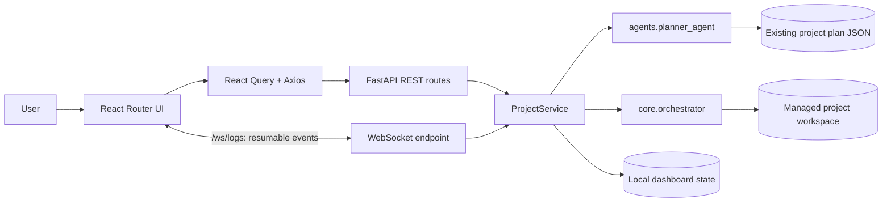

# AutoDev Version 5.1 Engineering Report

## Release scope

Version 5.1 adds a React dashboard and FastAPI interface over the existing
AutoDev planner and daily orchestrator. No AI or planning logic was moved to
the browser, and existing CLI and core APIs are retained.

## Delivered interface

- Dashboard, Projects, Execution, Roadmap, History, and Settings pages.
- Responsive dark SaaS layout with status cards, progress indicators, a
  reconnecting execution terminal, notifications, and mobile navigation.
- React Query data fetching, Axios REST client, TypeScript contracts, retry
  support, WebSocket event de-duplication, and browser online status.
- Project form with description, stack, duration, hours, repository, execution
  mode, and commit target.

## UI architecture diagram



## API documentation

The FastAPI OpenAPI reference is served at `/docs`; its schema is available at
`/openapi.json`. The API base URL is `http://localhost:8000`.

| Method | Path | Request / behavior |
| --- | --- | --- |
| `GET` | `/` | API identity, version, documentation, health links. |
| `GET` | `/health` | Backend health and version. |
| `POST` | `/project/create` | Project name, description, stack, days, working hours, daily commit target, GitHub repository, and execution mode. Calls the existing planner and returns the roadmap, first daily plan, progress, and metadata. |
| `POST` | `/project/start` | Optional `{ "project_id": "…" }`; begins one daily orchestrator run. |
| `POST` | `/project/pause` | Optional project ID; requests a pause after the current daily run completes. |
| `POST` | `/project/resume` | Optional project ID; starts the next daily run for a paused/waiting project. |
| `POST` | `/project/stop` | Optional project ID; requests a stop after the active daily run completes. |
| `GET` | `/project/status` | Optional `project_id`; execution state and progress. |
| `GET` | `/project/logs` | `after` event ID and `limit` (1–2000); persisted log history. |
| `GET` | `/project/roadmap` | Optional project ID; per-day milestones, statuses, commits, and completed validation summaries. |
| `GET` | `/project/day/{day}` | The requested roadmap day. |
| `GET` | `/project/history` | Project execution summaries, repositories, and dates. |
| `GET` | `/github/status` | Current configured repository and local GitHub CLI availability/authentication. |
| `GET` | `/benchmarks` | Latest saved AutoDev benchmark report, when present. |
| `GET` | `/dashboard` | Dashboard project, progress, commit, and activity summary. |
| `GET` | `/metrics` | Project and commit counters. |
| `GET` | `/settings` | Backend URL and default UI settings. |

Project creation example:

```json
{
  "project_name": "Student Productivity App",
  "description": "Build a productivity platform",
  "tech_stack": ["React", "FastAPI", "MongoDB"],
  "days": 30,
  "working_hours": 3,
  "daily_commit_target": 4,
  "repository": "https://github.com/user/project",
  "mode": "autonomous"
}
```

Validation rejects blank project descriptions/names, invalid day/hour/commit
limits, and repository URLs outside GitHub HTTPS or SSH. The backend reports
execution failures as explicit errors in status and streamed events.

## WebSocket event specification

Connect to `ws://localhost:8000/ws/logs`. Events are JSON objects:

```json
{
  "event_id": 8,
  "timestamp": "2026-10-24T06:00:00+00:00",
  "level": "info",
  "event": "execution.progress",
  "message": "Building code and running validation...",
  "day": 4,
  "data": {}
}
```

`event_id` is monotonically increasing and is the reconnect cursor. Connect with
`/ws/logs?after=<last_event_id>` to replay persisted events and then receive new
ones. The browser de-duplicates replayed events. Event history is persisted
without a retention cap; REST pages are limited to 2,000 events per request.
Event names include `planning.completed`, `execution.started`,
`execution.progress`, `execution.pause_requested`,
`execution.stop_requested`, `execution.day_completed`, and `execution.failed`.
Timestamps are UTC ISO-8601; `level` is `info`, `warning`, or `error`.

## Screenshots (placeholders)

- Dashboard — `docs/screenshots/v51-dashboard.png`
- Projects / new project — `docs/screenshots/v51-projects.png`
- Execution terminal — `docs/screenshots/v51-execution.png`
- Roadmap — `docs/screenshots/v51-roadmap.png`
- History and benchmarks — `docs/screenshots/v51-history.png`
- Settings — `docs/screenshots/v51-settings.png`

The screenshot paths are placeholders; no screenshots were captured in this
headless implementation environment.

## Test summary

- Incremental API contract tests (`tests/test_web_ui_api.py`): **5 passed**.
- Full repository suite, run once after implementation: **2,474 passed** in
  **148.50 seconds**.
- Frontend `npm run build`: **passed** (TypeScript build and Vite production
  bundle).
- The test run reported one Starlette deprecation warning because its
  `TestClient` currently uses `httpx`; there were no test failures.
- During development, change detection, incremental indexing, cache management,
  impact analysis, and test selection were used to keep test execution focused
  on the affected API contract file.

The complete-suite pass count includes the five new Version 5.1 API tests.

## Benchmark summary

The `/benchmarks` endpoint exposes the existing saved AutoDev benchmark report;
opening the dashboard does not trigger a full repository or engine benchmark.
A local in-process FastAPI smoke benchmark sent 60 successful `GET /health`
requests through `TestClient`:

| Measurement | Result |
| --- | ---: |
| Mean latency | 3.690 ms |
| Median latency (p50) | 2.800 ms |
| p95 latency | 5.410 ms |
| Minimum | 2.254 ms |
| Maximum | 25.244 ms |

These are local in-process smoke measurements, not network or production
performance guarantees. The Vite production bundle contained a 318.74 kB
JavaScript asset (99.64 kB gzip) and a 25.06 kB CSS asset (5.66 kB gzip).
