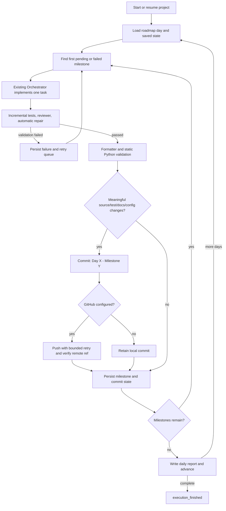
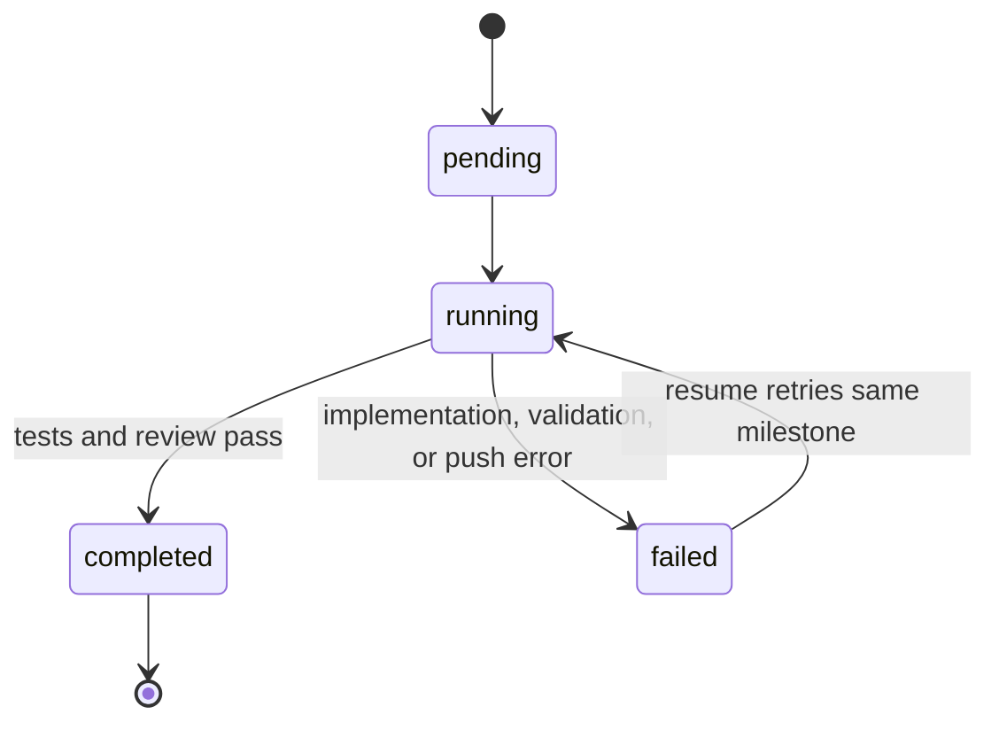

# AutoDev Version 5.2 Engineering Report

## Scope and compatibility

Version 5.2 adds persisted daily/milestone execution, guarded meaningful
commits, bounded GitHub push retries with remote verification, per-day reports,
and execution telemetry in the V5.1 dashboard. The planner, CLI, and public
Orchestrator API are unchanged. V5.1 REST routes, dotted WebSocket events, and
the injected one-day execution-runner contract are preserved.

The production project runner submits each persisted roadmap task as exactly
one task to the existing `Orchestrator`. Its existing incremental test,
reviewer, and repair pipeline remains authoritative. The adapter suppresses
the orchestrator's automatic commit so the V5.2 commit scheduler can validate,
format, stage, and commit after task review. Project state is stored beneath
`~/.autodev/web-ui/projects/<project-id>/memory/`.

## Execution flow



## Milestone lifecycle



Every state transition is atomically persisted in `memory/execution/day_X.json`.
Completed milestones are skipped on resume. A local commit created before a
push failure is recorded with its milestone ID; resume retries publishing that
same hash rather than creating a duplicate commit. FastAPI startup detects
projects persisted as `running` and resumes them automatically.

## GitHub commit lifecycle

```mermaid
sequenceDiagram
    participant E as DayExecutionEngine
    participant S as CommitScheduler
    participant G as GitAgent
    participant H as GitHubExecution
    E->>S: Inspect changed workspace files
    S->>S: Reject empty and whitespace-only changes
    S->>G: Stage eligible source/test/docs/config files
    G-->>E: Day X - Milestone title and commit hash
    opt Repository configured
        E->>H: Push commit
        H->>G: Push to active branch
        H->>G: Read remote branch with ls-remote
        alt Verified
            H-->>E: Verified commit hash
        else Push rejected
            H->>G: Bounded retry; rebase remote branch for non-fast-forward
            H-->>E: Retry result or explicit error
        end
    end
    E->>E: Persist hash and milestone state
```

Only files with source, test, documentation, or configuration extensions are
eligible; generated cache, memory, log, backup, and temporary paths are
excluded. A local commit is never empty. The daily commit target is a target,
not a reason to create filler commits; all planned milestones complete even
when fewer than the target number contain meaningful changes.

## API documentation

Existing Version 5.1 endpoints remain available:

| Method | Path | Description |
| --- | --- | --- |
| `GET` | `/` | API identity and links |
| `GET` | `/health` | Health check |
| `POST` | `/project/create` | Generate a roadmap using the existing planner |
| `POST` | `/project/start` | Start autonomous execution |
| `POST` | `/project/pause` | Pause at the next milestone boundary |
| `POST` | `/project/resume` | Resume saved execution state |
| `POST` | `/project/stop` | Stop at the next milestone boundary |
| `GET` | `/project/status` | Progress, execution, GitHub, review, and milestone status |
| `GET` | `/project/logs` | Resumable execution event history |
| `GET` | `/project/roadmap` | Project roadmap |
| `GET` | `/project/day/{day}` | One roadmap day |
| `GET` | `/project/history` | Project history |
| `GET` | `/github/status` | Repository and GitHub CLI status |
| `GET` | `/benchmarks` | Existing benchmark report |
| `GET` | `/dashboard` | Dashboard summary |
| `GET` | `/metrics` | Project and commit counters |
| `GET` | `/settings` | Current UI settings |

Version 5.2 additions:

| Method | Path | Description |
| --- | --- | --- |
| `POST` | `/project/run-day` | Start/resume the autonomous execution loop |
| `POST` | `/project/run-milestone` | Start/resume from the first unfinished milestone |
| `POST` | `/project/create-commit` | Commit current meaningful workspace changes |
| `POST` | `/project/push` | Push the latest project commit and verify remote branch head |
| `POST` | `/project/review` | Read current review status; reviews execute in the milestone pipeline |
| `GET` | `/project/current-day` | Current execution state and roadmap phase |
| `GET` | `/project/current-milestone` | Active milestone and persisted execution state |
| `GET` | `/project/commits` | Stored commits and file metadata |
| `GET` | `/project/report` | Latest report or a report selected with `?day=N` |

Action routes accept an optional `{"project_id": "<id>"}` JSON body. Unknown
projects/days return 404; invalid lifecycle actions and execution failures
return 409. The OpenAPI schema is available at `/docs`.

## WebSocket event specification

Connect to `/ws/logs?after=<event_id>`. The server replays persisted events
after the supplied ID and then streams new events. Each JSON message uses:

```json
{
  "event_id": 17,
  "timestamp": "2026-01-01T12:00:00+00:00",
  "level": "info",
  "event": "milestone_started",
  "message": "Executing milestone: Authentication API",
  "day": 4,
  "data": {"milestone_id": "day-4-milestone-2"}
}
```

| Event | Meaning |
| --- | --- |
| `execution_started` | Project execution starts or resumes |
| `milestone_started` | A milestone begins |
| `milestone_completed` | The milestone validates and completes |
| `review_started` | Existing reviewer/test pipeline begins |
| `review_completed` | Review/validation outcome is available |
| `commit_created` | A meaningful local commit is recorded |
| `push_started` | GitHub push begins |
| `push_completed` | Remote branch contains the pushed hash |
| `day_completed` | All milestones for a roadmap day complete |
| `execution_finished` | All planned days complete |

The original V5.1 dotted event names are retained alongside the V5.2 events.

## Daily report

`memory/reports/day_X.md` contains completed tasks, commits, test pass rate,
formatter/static validation results, files changed, duration, recovered and
unresolved problems, and the next-day preview. A report is written for both
successful and failed day runs.

## Screenshots placeholder list

- `docs/screenshots/v52-execution.png` — current milestone and execution controls
- `docs/screenshots/v52-github-lifecycle.png` — commit, review, and push statuses
- `docs/screenshots/v52-day-report.png` — completed day and report view

## Validation summary

- Incremental workflow: `RepositoryChangeDetector`, isolated `CacheManager`,
  `IncrementalIndexer.update_files`, `ImpactAnalyzer`, and `TestSelector`.
- Selected affected tests: `tests/test_v52_execution.py`,
  `tests/test_web_ui_api.py`, `tests/test_project_environment_detector.py`, and
  `tests/test_project_manager.py`.
- Focused result: 26 passed; one existing Starlette/httpx deprecation warning.
- Frontend production build: passed (`tsc -b` and Vite).
- Complete repository suite: 2,482 passed in 145.72 seconds; one existing
  Starlette/httpx deprecation warning. This was the only full-suite run.

## Benchmark summary

Local smoke benchmark (100 requests, FastAPI `TestClient`; temporary project
storage): `/health` mean 2.602 ms, p50 2.479 ms, p95 2.746 ms. A 10-milestone
state-persistence run completed in 5.614 ms total (0.561 ms/milestone). These
are local single-run measurements, not production capacity claims.
End-to-end generation and GitHub push latency depend on the configured model
provider and remote network and are excluded from this reproducible local
baseline.
